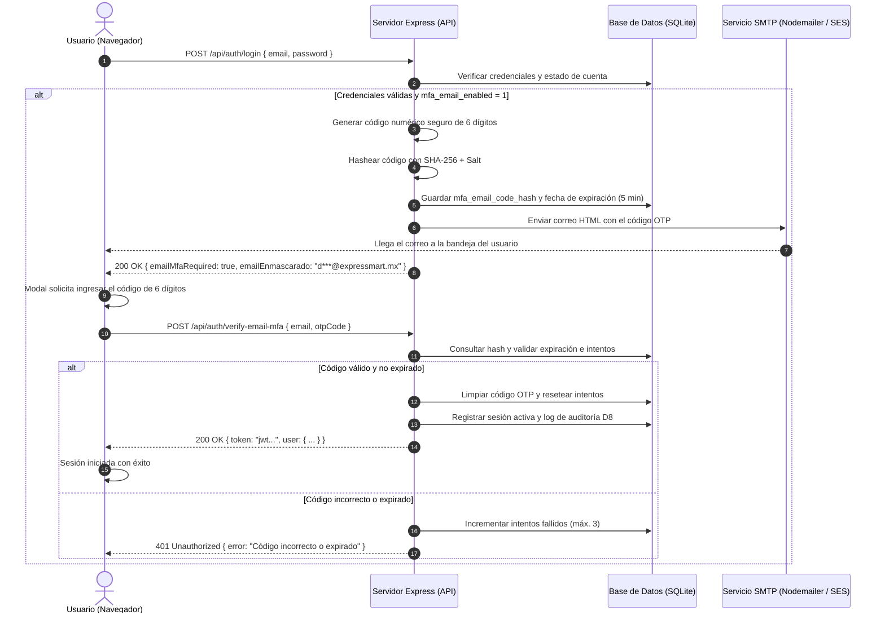

# Guía de Implementación: Verificación en Dos Pasos por Correo (Email 2FA / OTP)

**Documento:** Arquitectura e Implementación de Segundo Factor de Autenticación por Correo Electrónico  
**Código:** GUI-SEC-2FA-MAIL  
**Proyecto:** ExpressMart E-Commerce  
**Estándares de Referencia:** OWASP ASVS v4.0 (Sección V2 - Authentication), NIST SP 800-63B, ISO/IEC 27001  

---

## 1. Visión General y Comparativa

Actualmente, ExpressMart cuenta con autenticación de dos factores basada en **TOTP** (*Time-based One-Time Password* — RFC 6238) para roles privilegiados (como Administrador y Vendedor).

La **Verificación en Dos Pasos por Correo (Email 2FA)** complementa o reemplaza la necesidad de aplicaciones autenticadoras (Google Authenticator, Microsoft Authenticator) permitiendo que cualquier usuario reciba un código de seguridad de 6 dígitos de un solo uso (*OTP - One Time Password*) directamente en su bandeja de entrada.

### Comparativa: TOTP vs. Email 2FA

| Característica | TOTP (App Autenticadora) | Verificación por Correo (Email 2FA) |
| :--- | :--- | :--- |
| **Dependencia de Red** | No requiere internet (offline) | Requiere conexión para recibir el correo |
| **Experiencia de Usuario** | Requiere instalar app y escanear QR | Muy familiar para cualquier cliente |
| **Vigencia del Código** | 30 a 60 segundos | 5 a 10 minutos (configurable) |
| **Almacenamiento del Secreto** | Clave secreta estática cifrada | Código efímero temporal hasheado |
| **Costo Operativo** | Cero | Consumo de cuota del servicio SMTP / API |

---

## 2. Flujo de Autenticación de Dos Pasos por Correo



---

## 3. Pasos Técnicos para su Integración en ExpressMart

### Paso 1: Extensión del Esquema de Base de Datos

En [`src/db/database.js`](file:///home/diego/Documentos/pauditoria/src/db/database.js), se agregan 4 columnas a la tabla `usuarios`:

```sql
ALTER TABLE usuarios ADD COLUMN mfa_email_enabled INTEGER NOT NULL DEFAULT 0;
ALTER TABLE usuarios ADD COLUMN mfa_email_code_hash TEXT;
ALTER TABLE usuarios ADD COLUMN mfa_email_expires_at TEXT;
ALTER TABLE usuarios ADD COLUMN mfa_email_attempts INTEGER NOT NULL DEFAULT 0;
```

---

### Paso 2: Configuración del Proveedor de Correo (Nodemailer)

Instalar la librería de transporte de correo:
```bash
npm install nodemailer
```

En [`src/config/env.js`](file:///home/diego/Documentos/pauditoria/src/config/env.js), configurar las variables SMTP:

```javascript
smtp: {
  host: process.env.SMTP_HOST || 'smtp.gmail.com',
  port: Number(process.env.SMTP_PORT || 587),
  secure: process.env.SMTP_SECURE === 'true',
  user: process.env.SMTP_USER || '',
  pass: process.env.SMTP_PASS || '',
  from: process.env.SMTP_FROM || 'ExpressMart Seguridad <seguridad@expressmart.mx>'
}
```

---

### Paso 3: Servicio de Generación y Envío de Códigos OTP

Crear un módulo `src/services/emailOtpService.js`:

```javascript
const crypto = require('crypto');
const nodemailer = require('nodemailer');
const { getConfig } = require('../config/env');

// Generador criptográficamente seguro de 6 dígitos
function generateNumericOtp() {
  return String(crypto.randomInt(100000, 999999));
}

// Función hash para almacenar el código sin exponerlo en texto claro
function hashOtp(code) {
  return crypto.createHash('sha256').update(String(code).trim()).digest('hex');
}

// Configurar transportador
function getTransporter() {
  const { smtp, env } = getConfig();
  if (env === 'test' || !smtp.user) {
    // Modo simulado / desarrollo sin servidor SMTP real
    return {
      sendMail: async (options) => {
        console.log(`[SIMULADOR EMAIL 2FA] Enviando a: ${options.to} | Código: ${options.otpDebug}`);
        return { messageId: `sim_${Date.now()}` };
      }
    };
  }

  return nodemailer.createTransport({
    host: smtp.host,
    port: smtp.port,
    secure: smtp.secure,
    auth: { user: smtp.user, pass: smtp.pass }
  });
}

// Plantilla HTML del correo
async function sendOtpEmail({ toEmail, nombre, otpCode }) {
  const transporter = getTransporter();
  const htmlContent = `
    <div style="font-family: Arial, sans-serif; max-width: 520px; margin: 0 auto; padding: 24px; border: 1px solid #e2e8f0; rounded: 12px; background: #ffffff;">
      <div style="text-align: center; margin-bottom: 20px;">
        <h2 style="color: #0c1e3d; margin: 0;">ExpressMart México</h2>
        <p style="color: #64748b; font-size: 14px; margin-top: 4px;">Portal de Seguridad y Autenticación</p>
      </div>
      <p style="color: #1e293b; font-size: 15px;">Hola, <strong>${nombre}</strong>:</p>
      <p style="color: #334155; font-size: 14px; line-height: 1.5;">
        Has solicitado iniciar sesión en ExpressMart. Usa el siguiente código de verificación de 6 dígitos para completar tu acceso:
      </p>
      <div style="text-align: center; margin: 25px 0;">
        <span style="display: inline-block; font-size: 32px; font-weight: 800; letter-spacing: 6px; color: #123580; background: #f1f5f9; padding: 12px 28px; border-radius: 8px; border: 1px dashed #94a3b8;">
          ${otpCode}
        </span>
      </div>
      <p style="color: #64748b; font-size: 13px;">
        ⏳ Este código tiene una vigencia de <strong>5 minutos</strong> y solo puede ser utilizado una vez.
      </p>
      <hr style="border: none; border-top: 1px solid #e2e8f0; margin: 20px 0;" />
      <p style="color: #94a3b8; font-size: 11px; line-height: 1.4;">
        Si no intentaste iniciar sesión, por favor cambia tu contraseña inmediatamente y contacta a <a href="mailto:soporte@expressmart.mx" style="color: #1d4e9a;">soporte@expressmart.mx</a>.
      </p>
    </div>
  `;

  return transporter.sendMail({
    from: '"ExpressMart Seguridad" <seguridad@expressmart.mx>',
    to: toEmail,
    subject: `Tu código de verificación ExpressMart: ${otpCode}`,
    html: htmlContent,
    otpDebug: otpCode
  });
}

module.exports = {
  generateNumericOtp,
  hashOtp,
  sendOtpEmail
};
```

---

### Paso 4: Endpoints en Express

#### A. Flujo en `POST /api/auth/login`:
Cuando el usuario tiene `mfa_email_enabled === 1`:
```javascript
if (user.mfa_email_enabled) {
  const otpCode = generateNumericOtp();
  const codeHash = hashOtp(otpCode);
  const expiresAt = new Date(Date.now() + 5 * 60 * 1000).toISOString(); // 5 min TTL

  db.prepare(`
    UPDATE usuarios 
    SET mfa_email_code_hash = ?, mfa_email_expires_at = ?, mfa_email_attempts = 0 
    WHERE id = ?
  `).run(codeHash, expiresAt, user.id);

  await sendOtpEmail({ toEmail: user.email, nombre: user.nombre, otpCode });

  return res.json({
    emailMfaRequired: true,
    message: 'Se ha enviado un código de verificación de 6 dígitos a tu correo.',
    emailEnmascarado: user.email.replace(/(.{2})(.*)(@.*)/, '$1***$3')
  });
}
```

#### B. Nuevo Endpoint: `POST /api/auth/verify-email-mfa`:
```javascript
app.post('/api/auth/verify-email-mfa', (req, res) => {
  const { email, otpCode } = req.body || {};
  if (!email || !otpCode) {
    return res.status(400).json({ error: 'Correo y código son requeridos.' });
  }

  const db = getDb();
  const user = db.prepare('SELECT * FROM usuarios WHERE LOWER(email) = LOWER(?)').get(String(email).trim());
  if (!user || !user.mfa_email_code_hash) {
    return res.status(401).json({ error: 'Solicitud no válida o expirada.' });
  }

  // 1. Verificar límite de intentos (máximo 3)
  if (user.mfa_email_attempts >= 3) {
    db.prepare('UPDATE usuarios SET mfa_email_code_hash = NULL WHERE id = ?').run(user.id);
    return res.status(429).json({ error: 'Has superado el límite de intentos. Inicia sesión nuevamente.' });
  }

  // 2. Verificar vigencia temporal (TTL)
  if (new Date() > new Date(user.mfa_email_expires_at)) {
    db.prepare('UPDATE usuarios SET mfa_email_code_hash = NULL WHERE id = ?').run(user.id);
    return res.status(401).json({ error: 'El código ha expirado. Solicita uno nuevo.' });
  }

  // 3. Comparar Hash seguro
  const providedHash = hashOtp(otpCode);
  if (providedHash !== user.mfa_email_code_hash) {
    db.prepare('UPDATE usuarios SET mfa_email_attempts = mfa_email_attempts + 1 WHERE id = ?').run(user.id);
    return res.status(401).json({ error: 'Código de verificación incorrecto.' });
  }

  // 4. Código válido: Iniciar sesión y limpiar código usado (Single-Use OTP)
  db.prepare(`
    UPDATE usuarios 
    SET mfa_email_code_hash = NULL, mfa_email_expires_at = NULL, mfa_email_attempts = 0 
    WHERE id = ?
  `).run(user.id);

  const session = createSession(db, {
    usuarioId: user.id,
    rol: user.rol,
    mfaVerificado: 1,
    ip: req.ip || '127.0.0.1'
  });

  return res.json({
    message: 'Inicio de sesión completado con éxito.',
    token: session.tokenId,
    user: {
      id: user.id,
      email: user.email,
      nombre: user.nombre,
      rol: user.rol
    }
  });
});
```

---

## 4. Medidas de Seguridad Críticas (Normas OWASP & ISO 27001)

1. **No almacenar OTP en texto plano:** Siempre almacenar `SHA-256(otp)` en la base de datos para que una copia o respaldo de la BD no permita a un tercero usar códigos activos.
2. **Expiración Estricta (TTL Corto):** Máximo 5 a 10 minutos de vida.
3. **Límite de Intentos (Brute-Force Protection):** Máximo 3 intentos por código. Al tercer fallo, el código se destruye inmediatamente.
4. **Token de Un Solo Uso (Single-Use):** Una vez verificado con éxito, el campo `mfa_email_code_hash` se vuelve `NULL` para evitar ataques de repetición (*Replay Attacks*).
5. **Rate Limiting de Reenvíos:** Permitir solicitar un nuevo correo solo tras 60 segundos de espera para proteger la reputación del dominio emisor y evitar abuso de cuota.
