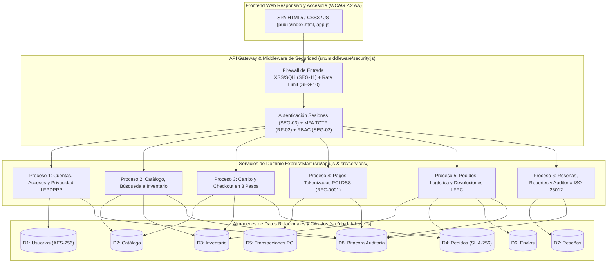

# Diseño Arquitectónico, Contratos de API, Estándares de Programación y Configuración (Apartados 11, 13, 14, 15 y 20 - MC-001)

**Código de Documento:** ARQ-MC-001  
**Versión:** 1.0  
**Fecha:** 21/10/2026  

---

## 1. Metodología Ágil Scrum + DevOps y Plan de Desarrollo (Apartado 11)

El desarrollo de **ExpressMart** se ejecutó en 5 fases incrementales (Sprints de 2 semanas) combinando ceremonias Scrum (Sprint Planning, Daily Stand-up, Sprint Review y Retrospectiva) con prácticas DevOps y banderas de funcionalidad (`featureFlags` en [`src/config/env.js`](../src/config/env.js)):

| Fase / Sprint | Entregables Completados | Estado | Avance Real |
|---|---|---|---|
| **Fase 1: Configuración Base e Infraestructura** | Repositorio Git con modelo de ramas (`main`, `develop`, `feature/*`, `release/v1.0.0`, `hotfix/*`), esquema SQLite `D1..D8`, contratos de API y pipeline CI/CD. | Cumple (C) | **100%** |
| **Fase 2: Módulo del Cliente – Catálogo y Búsqueda** | Registro/autenticación (`DEV-01`), catálogo (`DEV-02`), búsqueda y filtros `< 2s` (`DEV-03`) e interfaz web responsiva y accesible WCAG 2.2. | Cumple (C) | **100%** |
| **Fase 3: Núcleo Transaccional – Carrito y Checkout** | Carrito validado en servidor (`DEV-04`), checkout en 3 pasos (`DEV-05`), pasarela PCI DSS con reintentos `RFC-0001` (`DEV-06`) y firma de integridad SHA-256. | Cumple (C) | **100%** |
| **Fase 4: Interfaz de Administrador y Operaciones** | Gestión de pedidos (`DEV-07`), inventario (`DEV-08`), envíos/guías DHL (`DEV-09`), panel administrativo con MFA (`DEV-10`), reseñas y notificaciones. | Cumple (C) | **100%** |
| **Fase 5: Pruebas Integrales, QA y Liberación** | Suite automatizada con `91.48%` de cobertura (`DEV-11`) y documentación técnica, operativa y de auditoría actualizada (`DEV-12`). | Cumple (C) | **100%** |

---

## 2. Arquitectura de Componentes y Almacenes de Datos DFD Nivel 0 y Nivel 1 (Apartado 13 y 41)

Los diagramas oficiales de flujo de datos se encuentran integrados en:
- [`docs/diagrams/dfd-nivel-0.png`](./diagrams/dfd-nivel-0.png): **DFD Nivel 0 — Diagrama de Contexto** (Entidades externas: *Cliente/Comprador*, *Vendedor*, *Administrador de la plataforma*, *Pasarela de pagos*, *Proveedor de paquetería*, *Servicio de notificaciones*).
- [`docs/diagrams/dfd-nivel-1.png`](./diagrams/dfd-nivel-1.png): **DFD Nivel 1 — Descomposición del Proceso 0** en 6 procesos principales y 8 almacenes de datos (`D1` a `D8`).

---

## 3. Contratos de API REST (OpenAPI 3.0 Resumen - Apartados 13 y 14)

| Método y Endpoint | Proceso DFD / Requisito | Autenticación / Rol (RBAC) | Códigos HTTP | Descripción |
|---|---|---|---|---|
| `GET /api/health` | Monitoreo (`Apartado 35`) | Público | `200` | Estado de salud, ambiente activo, versión, RTO/RPO y banderas de funcionalidad. |
| `GET /api/metrics` | KPIs (`Apartados 7 y 38`) | Público / Monitoreo | `200` | Indicadores clave de disponibilidad, latencia promedio y p95 de checkout, cobertura y seguridad. |
| `GET /api/legal/privacy-and-terms` | `NOR-08` (LFPDPPP) y `NOR-09` (LFPC) | Público | `200` | Aviso de Privacidad Integral y Términos y Condiciones de Compra al Consumidor. |
| `POST /api/auth/register` | Proceso 1 · `RF-01` | Público | `201, 400, 409` | Registro con validación OWASP ASVS, consentimiento LFPDPPP y cifrado AES-256. |
| `POST /api/auth/login` | Proceso 1 · `RF-01, RF-02` | Público | `200, 401, 423` | Inicio de sesión con bloqueo por fuerza bruta (5 intentos) y verificación MFA TOTP. |
| `POST /api/auth/logout` | Proceso 1 · `SEG-03` | Sesión activa | `200, 401` | Cierre seguro y revocación inmediata del token de sesión. |
| `GET / PUT /api/auth/profile` | Proceso 1 · `RF-01` | Sesión activa | `200, 401` | Consulta y actualización de perfil con descifrado/cifrado en reposo. |
| `POST /api/privacy/arco` | Proceso 1 · `NOR-08` | Sesión activa | `201, 400` | Solicitud y atención de derechos ARCO (Acceso, Rectificación, Cancelación, Oposición). |
| `GET /api/products` | Proceso 2 · `RF-03, RNF-05` | Público | `200` | Búsqueda y filtrado por nombre, categoría, marca, precio y orden en `< 2 s`. |
| `GET /api/products/:id` | Proceso 2 · `RF-03, RF-08` | Público | `200, 404` | Ficha técnica del producto, existencias y reseñas verificadas. |
| `POST / PUT /api/products` | Proceso 2 · `RF-06, SEG-04` | `administrador`, `vendedor` (MFA) | `200, 201, 400, 403, 409` | Alta y edición de productos e inventario validando completitud ISO/IEC 25012. |
| `POST /api/cart/calculate` | Proceso 3 · `RF-04, SEG-05` | Público | `200, 400, 404, 409` | Cálculo del lado servidor de subtotal, IVA 16%, envío y cupones promocionales. |
| `POST /api/checkout` | Procesos 3 y 4 · `RF-05, RNF-09, RNF-11` | Sesión activa | `201, 400, 402, 409` | Compra atómica en 3 pasos, cobro PCI DSS con reintentos, guía DHL y notificación. |
| `GET /api/orders` | Proceso 5 · `RF-07` | Sesión activa | `200` | Historial de pedidos, estado de pago, guía de envío y firma de integridad. |
| `PATCH /api/orders/:id/status` | Proceso 5 · `RF-07` | `administrador`, `vendedor`, `soporte` | `200, 400, 404` | Actualización de estado del pedido/envío y notificación automática al comprador. |
| `POST /api/orders/:id/return` | Proceso 5 · `RF-07, NOR-09` | Cliente propietario / `administrador` | `200, 400, 403, 404` | Devolución amparada en LFPC con reintegro de stock y reembolso en pasarela. |
| `POST /api/products/:id/reviews` | Proceso 6 · `RF-08` | Sesión activa | `201, 400, 404` | Registro de calificación (1 a 5 estrellas) y comentario verificado. |
| `GET /api/reports/summary` | Proceso 6 · `RF-10` | `administrador`, `vendedor`, `auditor` | `200, 403` | Reporte ejecutivo de ventas, ticket promedio e inventario. |
| `GET /api/quality/data-audit` | Proceso 6 · `ISO/IEC 25012` | `administrador`, `auditor` | `200, 403` | Verificación en vivo de Integridad, Exactitud, Completitud, Consistencia y Actualidad. |
| `GET /api/audit-logs` | Proceso 6 · `SEG-15` | `administrador`, `auditor` | `200, 403` | Consulta de la bitácora `D8` y validación criptográfica de la cadena SHA-256. |

---

## 4. Estándares de Programación, Gestión de Configuración y Ambientes (Apartados 14, 15 y 20)

1. **Convenciones de Nomenclatura (Apartado 14):**
   - Variables y funciones en JavaScript: `camelCase` (`calculateCartTotals`, `verifyTotpCode`).
   - Constantes globales y parámetros de entorno: `UPPER_SNAKE_CASE` (`IVA_RATE`, `FREE_SHIPPING_THRESHOLD`).
   - Tablas y columnas en SQLite: `snake_case` (`bitacora_auditoria`, `direccion_envio_cifrada`).
   - Verificación automatizada mediante [`scripts/static-analysis.js`](../scripts/static-analysis.js) (`npm run lint`).
2. **Modelo de Ramas Git y Versionado Semántico (Apartados 15.1 y 32):**
   - Ramas estructuradas: `main` (producción), `develop` (integración), `feature/catalogo-busqueda`, `feature/checkout-pagos`, `release/v1.0.0`, `hotfix/timeout-pasarela`.
   - Etiquetas semánticas: `v0.1.0` (Configuración base), `v0.5.0` (Núcleo transaccional), `v1.0.0` (Liberación final auditada).
3. **Inventario de Configuración por Ambiente (Apartado 20):**
   - Definido y controlado en [`src/config/env.js`](../src/config/env.js) para los 4 ambientes obligatorios: `development`, `test`, `staging` y `production`, garantizando aislamiento de datos sintéticos en pruebas y paridad entre `staging` y `production`.
