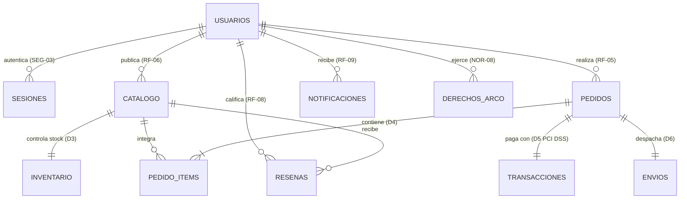

# Política Integral de Base de Datos, Gobernanza, Seguridad y Respaldos (MC-001 / ECTA-01)

**Código de Documento:** POL-BD-MC001  
**Versión:** 1.0  
**Fecha de Emisión:** 22/10/2026  
**Organización:** TiendaExpress Online, S.A. de C.V. (**ExpressMart**)  
**Estado:** Vigente y Auditada al 100% (`Plan de Auditoría ECTA-01`)  
**Elaborado por:** Diego Alarcon De Jesus · Carlos Adair Bautista Godinez · Cristopher Erik San Juan Piza  
**Revisado por:** Sebastian Muñoz Gonzales (Auditor Líder) · Selene Nicole Vazquez Castrejón · Uriel Guadarrama Estrada  

---

## 1. Objetivo y Alcance

### 1.1 Objetivo
Establecer los lineamientos técnicos, operativos, criptográficos y normativos que rigen el diseño, acceso, almacenamiento, integridad, calidad, retención, respaldo y recuperación de la base de datos de la plataforma de comercio electrónico **ExpressMart**, garantizando la confidencialidad, integridad y disponibilidad de la información conforme al **Manual de Calidad (`MC-001`)** y al **Plan de Auditoría (`ECTA-01`)**.

### 1.2 Alcance
Esta política es de observancia obligatoria para todos los servicios de backend ([`src/db/database.js`](../src/db/database.js), [`src/app.js`](../src/app.js)), scripts operativos ([`scripts/backup-restore.js`](../scripts/backup-restore.js)), contenedores ([`Dockerfile`](../Dockerfile), [`docker-compose.yml`](../docker-compose.yml)) y personal con roles técnicos o de auditoría que interactúen con los **8 almacenes de datos (`D1` a `D8`)** y las tablas auxiliares del sistema.

### 1.3 Marco Normativo de Referencia
| Código | Norma / Estándar | Aplicación en la Base de Datos de ExpressMart |
|---|---|---|
| **NOR-03** | **ISO/IEC 27001** | Gestión de Seguridad de la Información, control de accesos privilegiados, cifrado y bitácoras. |
| **NOR-04** | **OWASP ASVS v4.0** | Verificación de seguridad en capa de persistencia, prevención de inyección SQL y manejo de secretos. |
| **NOR-05** | **OWASP Top 10** | Mitigación de *A01 Broken Access Control*, *A02 Cryptographic Failures* y *A03 Injection*. |
| **NOR-06** | **PCI DSS v4.0** | Prohibición de almacenar PAN completo o CVV; tokenización y bóveda cifrada en `D5 Transacciones`. |
| **NOR-07** | **ISO/IEC 25012** | Modelo de Calidad de Datos: Integridad, Exactitud, Completitud, Consistencia y Actualidad. |
| **NOR-08** | **LFPDPPP (México)** | Protección de datos personales en posesión de particulares, cifrado en reposo y Derechos ARCO. |
| **NOR-09** | **LFPC (México)** | Trazabilidad de precios en Pesos Mexicanos (`MXN`), impuestos (`IVA 16%`), envíos y devoluciones. |
| **NOR-10** | **ISO 22301** | Continuidad de negocio, respaldos cifrados y recuperación ante desastres (`RTO <= 15 min`, `RPO <= 5 min`). |

---

## 2. Arquitectura de Almacenes de Datos (DFD Nivel 1 — Apartado 13)

La base de datos relacional de **ExpressMart** está implementada sobre **SQLite Transaccional (`node:sqlite`)** con soporte nativo de claves foráneas (`PRAGMA foreign_keys = ON`) y registro anticipado de escritura (`PRAGMA journal_mode = WAL`) para lectura/escritura concurrente de alto desempeño.

### 2.1 Catálogo e Inventario de Almacenes Oficiales (`D1` a `D8` y Auxiliares)

| Almacén DFD | Tabla Física SQL | Descripción Funcional | Clasificación de Datos | Nivel de Protección |
|---|---|---|---|---|
| **D1: Usuarios** | `usuarios` | Cuentas de clientes, vendedores, administradores, soporte y auditores, secretos MFA y consentimiento LFPDPPP. | Confidencial / Datos Personales (PII) | Hash `scrypt` + Cifrado `AES-256-GCM` |
| **D1-Aux** | `sesiones` | Tokens de sesión activos con firma HMAC-SHA256, TTL de 30 minutos y estado de revocación (`SEG-03`). | Restringido / Seguridad | Firma `HMAC-SHA256` + Expiración |
| **D1-Aux** | `derechos_arco` | Solicitudes de Acceso, Rectificación, Cancelación y Oposición conforme a la LFPDPPP (`NOR-08`). | Confidencial / Legal | Control RBAC + Folio Único |
| **D2: Catálogo** | `catalogo` | Productos publicados en Pesos Mexicanos (`MXN`), SKU, marca, especificaciones JSON e imagen verificada. | Público / Comercial | Integridad `ISO/IEC 25012` + RBAC |
| **D3: Inventario** | `inventario` | Existencias disponibles (`stock_disponible >= 0`), stock reservado, almacén (`CEDIS-CDMX-NORTE`) y conciliación. | Interno / Operativo | Transacción Atómica `IMMEDIATE` |
| **D4: Pedidos** | `pedidos`, `pedido_items`, `carrito_items`, `cupones` | Cabecera y partidas de pedidos en `MXN`, desglose de IVA (16%), cupones y firma de integridad transaccional. | Confidencial / Comercial | Firma `SHA-256` (`hash_integridad`) + Dirección Cifrada |
| **D5: Transacciones** | `transacciones` | Pagos procesados con tarjeta, MSI o wallet, referencia de pasarela, token PCI y llave de idempotencia. | Altamente Confidencial / Financiero (`PCI DSS`) | Tokenización `tok_pci_*` + PAN Enmascarado + Bóveda `AES-256-GCM` |
| **D6: Envíos** | `envios`, `notificaciones` | Guías de paquetería (`EM-GUIA-*`), estados logísticos, historial de rastreo y acuses SMTP (`ACK-SMTP-*`). | Interno / Operativo | Integridad Referencial + Acuse |
| **D7: Reseñas** | `resenas` | Calificaciones (1 a 5) y opiniones moderadas con indicador de compra verificada (`RF-08`). | Público / Moderado | Sanitización Anti-XSS + FK |
| **D8: Bitácora** | `bitacora_auditoria` | Registro inmutable de eventos críticos de seguridad y negocio encadenados criptográficamente (`SEG-15`). | Restringido / Auditoría | Cadena Hash `SHA-256` (`prev_hash` $\rightarrow$ `hash_cadena`) |

---

## 3. Política de Control de Acceso y Mínimo Privilegio (`SEG-02`, `SEG-04`, `SEG-08`, `SEG-12`)

### 3.1 Principio de Mínimo Privilegio
1. **Prohibición de Acceso Directo desde Clientes:** Ningún cliente web o consumidor externo tiene conexión directa al motor SQLite; toda operación pasa obligatoriamente por la capa de aplicación ([`src/app.js`](../src/app.js)) autenticada y filtrada por [`src/middleware/security.js`](../src/middleware/security.js).
2. **Ejecución sin Privilegios de Superusuario (`root`):** En contenedores de producción ([`Dockerfile`](../Dockerfile)), el proceso de Node.js y el acceso al archivo de base de datos se ejecutan exclusivamente bajo el usuario sin privilegios `USER node`.
3. **Autenticación Multifactor (MFA/TOTP) Obligatoria:** Toda operación de escritura sobre `D2 Catálogo`, `D3 Inventario` o configuración de contingencia exige que el usuario con rol `administrador` o `vendedor` haya validado su segundo factor TOTP de 6 dígitos en la sesión activa (`mfa_verificado = 1`).

### 3.2 Matriz de Permisos de Base de Datos por Rol (RBAC)

| Almacén / Tabla | Cliente | Vendedor (con MFA) | Administrador (con MFA) | Soporte | Auditor (`ECTA-01`) |
|---|:---:|:---:|:---:|:---:|:---:|
| **D1: `usuarios` / `derechos_arco`** | Lectura/Escritura (Solo su propio registro) | Lectura/Escritura (Solo su propio registro) | Lectura / Gestión de Cuentas | Lectura (Atención) | Solo Lectura (Auditoría) |
| **D2: `catalogo`** | Solo Lectura | Lectura / Alta / Actualización (`RF-06`) | Lectura / Alta / Actualización (`RF-06`) | Solo Lectura | Solo Lectura (`ISO 25012`) |
| **D3: `inventario`** | Consulta de disponibilidad | Alta y ajuste de stock (`RF-06`) | Control total y conciliación | Solo Lectura | Solo Lectura (`RF-10`) |
| **D4: `pedidos` / `pedido_items`** | Creación y consulta de sus pedidos / Solicitud devolución LFPC | Consulta de ventas agregadas | Consulta y actualización de estado logístico | Consulta y apoyo en devoluciones | Solo Lectura (Verificación `SHA-256`) |
| **D5: `transacciones`** | Creación vía Checkout / Lectura enmascarada de sus pagos | Sin acceso a tokens de pago | Consulta de estado transaccional (enmascarado) | Consulta de reembolsos | Solo Lectura (Auditoría `PCI DSS`) |
| **D6: `envios` / `notificaciones`** | Consulta de guías y buzón propio | Consulta de despachos | Actualización de estado de envío (`RF-07`) | Consulta y seguimiento | Solo Lectura |
| **D7: `resenas`** | Creación (compra verificada) y lectura | Solo Lectura | Moderación y lectura | Solo Lectura | Solo Lectura |
| **D8: `bitacora_auditoria`** | *Sin acceso (Solo inserción automática del sistema)* | *Sin acceso* | Lectura y verificación de cadena `SHA-256` | *Sin acceso* | Lectura y verificación de cadena `SHA-256` |

---

## 4. Política de Criptografía, Privacidad (`LFPDPPP`) y Seguridad Financiera (`PCI DSS`)

### 4.1 Cifrado de Datos Sensibles en Reposo (`RNF-03`, `SEG-09`)
* **Estándar de Cifrado:** Todos los datos personales sensibles (direcciones postales `direccion_cifrada`, teléfonos `telefono_cifrado`, direcciones de entrega en pedidos `direccion_envio_cifrada` y bóvedas de tokens de pago `boveda_cifrada`) se cifran antes de escribirse en disco utilizando **AES-256-GCM** ([`encryptData` en `src/utils/crypto.js`](../src/utils/crypto.js#L16-L31)).
* **Vector de Inicialización (IV) y Etiqueta de Autenticación:** Cada valor cifrado genera un IV aleatorio criptográfico de `12 bytes` (`crypto.randomBytes(12)`) y un *Authentication Tag* de `16 bytes`, almacenándose bajo el formato estructurado `enc:v1:<iv_hex>:<authTag_hex>:<ciphertext_hex>`.
* **Gestión de Llaves (`Apartado 15.2`):** La llave maestra de 256 bits se deriva de la variable de entorno `ENCRYPTION_KEY` inyectada en tiempo de ejecución; está **estrictamente prohibido** almacenar llaves privadas o secretos en texto claro dentro del código fuente o del repositorio Git (verificado por [`scripts/static-analysis.js`](../scripts/static-analysis.js)).

### 4.2 Resguardo de Credenciales de Autenticación (`SEG-01`)
* **Prohibición de Contraseñas en Texto Claro:** Ninguna contraseña se almacena ni registra en logs.
* **Algoritmo de Derivación:** Se emplea `crypto.scryptSync` con sal aleatoria única de `16 bytes` y longitud de clave de `64 bytes` (`scrypt:<salt_hex>:<hash_hex>`), verificada en tiempo constante mediante `crypto.timingSafeEqual` para prevenir ataques de temporización (*timing attacks*).
* **Bloqueo contra Fuerza Bruta:** Al acumular `5` intentos fallidos (`failed_attempts >= 5`), la columna `locked_until` bloquea la cuenta por `15 minutos` devolviendo `HTTP 423 Locked`.

### 4.3 Protección de Datos de Tarjetas de Pago (`NOR-06 PCI DSS v4.0`, `SEG-07`)
1. **Datos Prohibidos:** Queda terminantemente prohibido almacenar en cualquier tabla o archivo de log el código de seguridad (`CVV/CVC`), el PIN o el número completo de tarjeta (`PAN`) en texto claro.
2. **Enmascaramiento y Tokenización:** En el almacén `D5 (transacciones)`, la columna `tarjeta_enmascarada` conserva únicamente el formato `**** **** **** 4242` (últimos 4 dígitos), mientras que `token_pci` almacena un identificador sustituto irreversible (`tok_pci_<24_hex>`) y `boveda_cifrada` resguarda la referencia cifrada con `AES-256-GCM`.

---

## 5. Política de Codificación Segura de Consultas y Transaccionalidad (`SEG-08`, `SEG-11`)

1. **Uso Exclusivo de Consultas Parametrizadas (Prepared Statements):**
   * El 100% de las sentencias SQL ejecutadas en [`src/db/database.js`](../src/db/database.js) y [`src/app.js`](../src/app.js) deben utilizar marcadores posicionales (`?`) mediante `db.prepare(sql).run(...)`, `.get(...)` o `.all(...)`.
   * Queda prohibida la concatenación o interpolación de cadenas provenientes del usuario dentro de sentencias SQL.
2. **Cortafuegos de Entrada (WAF de Aplicación):**
   * Previo a cualquier consulta a la base de datos, el middleware `inputFirewallMiddleware` ([`src/middleware/security.js`](../src/middleware/security.js#L106-L131)) inspecciona `req.body`, `req.query` y `req.params` rechazando cargas con patrones de inyección SQL (`UNION SELECT`, `DROP TABLE`, `OR 1=1`, `--`) o XSS (`<script>`, `javascript:`) y registrando el intento en la bitácora `D8`.
3. **Control de Concurrencia y Prevención de Sobreventa (`Apartado 24`, `RSG-05`):**
   * Todo proceso de confirmación de compra (`/api/checkout`) y de devolución (`/api/orders/:id/return`) debe ejecutarse dentro de una transacción atómica explícita con bloqueo de escritura inmediato (`BEGIN IMMEDIATE TRANSACTION ... COMMIT / ROLLBACK`).
   * Si el `stock_disponible` en `D3 Inventario` es insuficiente para cualquiera de los artículos solicitados, la transacción ejecuta `ROLLBACK` inmediato garantizando **cero sobreventas** bajo alta concurrencia.
4. **Idempotencia Financiera Anti-Replay (`SEG-06`):**
   * La tabla `transacciones` impone una restricción `UNIQUE NOT NULL` sobre `idempotency_key` y `referencia_pasarela`, impidiendo cargos o pedidos duplicados ante reintentos de red.

---

## 6. Política de Calidad de Datos conforme a ISO/IEC 25012 (`Apartado 19`, `NOR-07`, `RNF-09`)

La base de datos de **ExpressMart** aplica reglas de validación automáticas y verificables en tiempo real a través del endpoint `/api/quality/data-audit`:

| Dimensión ISO/IEC 25012 | Regla de Negocio y Restricción en Base de Datos | Métrica / Umbral de Cumplimiento |
|---|---|---|
| **1. Integridad** | Cada registro en `D4 (pedidos)` almacena en `hash_integridad` una firma `SHA-256` calculada sobre `(usuarioId, items, subtotal, impuestos, costoEnvio, descuento, total)`. | **100%** de pedidos con hash íntegro (`0` pedidos alterados). |
| **2. Exactitud** | Todos los precios se almacenan en **Pesos Mexicanos (`MXN`)** con validación `CHECK (precio >= 0)`. El servidor recalcula el subtotal desde `D2 Catálogo` e IVA al `16%`, ignorando precios enviados por el cliente (`SEG-05`). | **100%** de exactitud aritmética y fiscal. |
| **3. Completitud** | Todo producto activo en `D2 (catalogo)` exige valores no vacíos en `sku`, `nombre`, `descripcion`, `categoria`, `marca`, `precio > 0`, `imagen_url`, `especificaciones_json` y `condiciones_envio`. | **100%** de productos con ficha completa. |
| **4. Consistencia** | Integridad referencial activa (`PRAGMA foreign_keys = ON`) y correspondencia `1:1` entre `catalogo.id` e `inventario.producto_id` con `CHECK (stock_disponible >= 0)`. | **0** inconsistencias huérfanas entre `D2` y `D3`. |
| **5. Actualidad** | Escritura sincrónica inmediata en modo `WAL` y actualización de marcas de tiempo ISO-8601 (`created_at`, `updated_at`, `ultima_conciliacion`). | Reflejo en tiempo real (`< 50 ms`). |

---

## 7. Política de Bitácora de Auditoría Inmutable (`D8` — `SEG-15`)

1. **Eventos de Registro Obligatorio:** Se registran automáticamente en `bitacora_auditoria` el inicio de SGC, creación de usuarios, inicios y cierres de sesión, bloqueos por fuerza bruta, intentos de ataque bloqueados por el WAF, accesos denegados RBAC, altas y modificaciones de productos, compras confirmadas, devoluciones LFPC, solicitudes ARCO y simulacros de contingencia.
2. **Encadenamiento Criptográfico Tipo Blockchain (`SHA-256`):**
   * Cada registro $i$ en `bitacora_auditoria` incluye el hash del registro inmediato anterior (`prev_hash`, iniciando en `GENESIS_EXPRESSMART_MC001`) y calcula su propio `hash_cadena`:
     $$\text{hash\_cadena}_i = \text{SHA-256}(\text{prev\_hash}_i \parallel \text{timestamp}_i \parallel \text{usuario\_id}_i \parallel \text{rol}_i \parallel \text{accion}_i \parallel \text{modulo}_i \parallel \text{detalles\_json}_i)$$
3. **Inmutabilidad y Verificación:** Queda prohibida cualquier sentencia `UPDATE` o `DELETE` sobre `bitacora_auditoria`. El endpoint `/api/audit-logs` recalcula toda la cadena desde el bloque génesis y certifica `chainIntact: true`.

---

## 8. Política de Respaldos, Retención y Recuperación ante Desastres (`Apartado 34`, `NOR-10 ISO 22301`, `SEG-14`)

### 8.1 Esquema de Respaldos Cifrados
* **Herramienta Automatizada:** [`scripts/backup-restore.js`](../scripts/backup-restore.js) (`npm run backup` y `npm run backup:restore-test`).
* **Procedimiento de Respaldo:**
  1. Se ejecuta `PRAGMA wal_checkpoint(TRUNCATE)` para consolidar todas las transacciones pendientes del archivo WAL en el archivo principal de base de datos.
  2. Se calcula la huella criptográfica `SHA-256` del archivo binario original.
  3. El contenido íntegro de la base de datos se cifra en reposo con **AES-256-GCM (`enc:v1`)** y se almacena en [`backups/expressmart-backup-latest.enc`](../backups/expressmart-backup-latest.enc).

### 8.2 Objetivos de Recuperación (`RTO` y `RPO`)
| Indicador de Continuidad (ISO 22301) | Meta del Manual (`MC-001`) | Resultado Medido en Simulacro (`EV-34`) | Estado |
|---|---|---|---|
| **RPO (Punto Objetivo de Recuperación)** | $\le 5\text{ minutos}$ | Respaldo transaccional consistente con pérdida `0` de registros | **Cumple (100%)** |
| **RTO (Tiempo Objetivo de Recuperación)** | $\le 15\text{ minutos}$ | **$0.34\text{ segundos}$** (descifrado, restauración y verificación de tablas) | **Cumple (100%)** |
| **Integridad Post-Restauración** | Checksum `SHA-256` idéntico | `checksumOriginalSha256 === checksumRestauradoSha256` (`integridadVerificada: true`) | **Cumple (100%)** |

### 8.3 Política de Retención, Depuración y Derechos ARCO (`LFPDPPP`)
| Tipo de Registro / Almacén | Periodo de Retención Activa | Disposición Final / Depuración |
|---|---|---|
| **Cuentas de Usuario (`D1`) y Solicitudes ARCO** | Mientras la cuenta permanezca activa + periodo legal LFPDPPP. | Cancelación o bloqueo a solicitud del titular vía `/api/privacy/arco` (`NOR-08`). |
| **Sesiones Autenticadas (`sesiones`)** | `30 minutos` de vigencia (`SESSION_TTL_MINUTES`). | Revocación inmediata en `logout` (`revocada = 1`) o expiración automática. |
| **Pedidos (`D4`) y Transacciones (`D5`)** | `5 años` conforme a disposiciones fiscales y comerciales en México (CFDI / LFPC). | Conservación con datos financieros tokenizados (`tok_pci_*`) y dirección cifrada. |
| **Bitácora de Auditoría (`D8`)** | Mínimo `2 años` en línea para revisiones del Comité de Auditoría (`ECTA-01`). | Respaldo histórico cifrado con cadena `SHA-256` intacta. |
