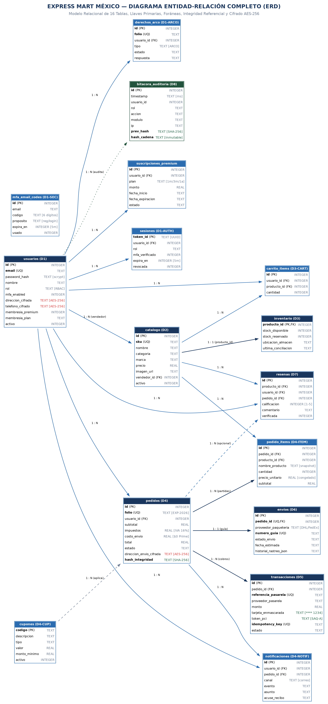
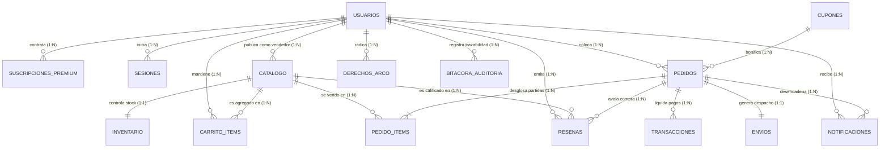
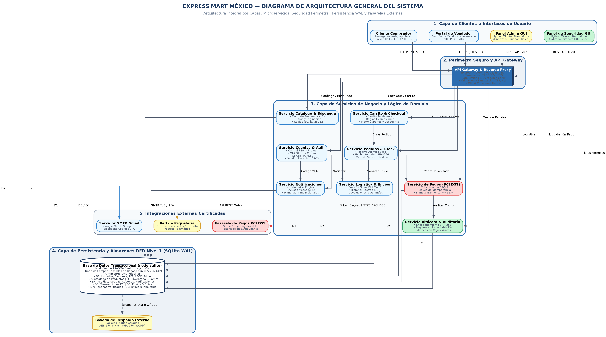
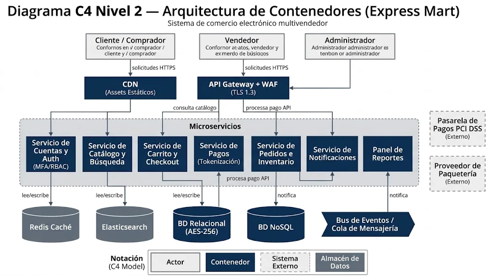
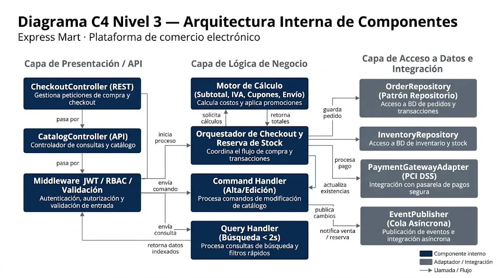
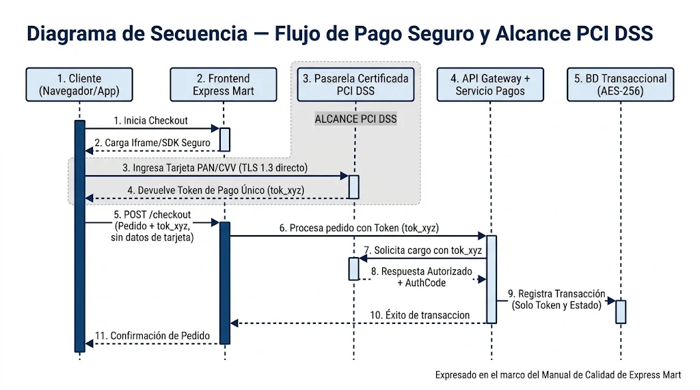
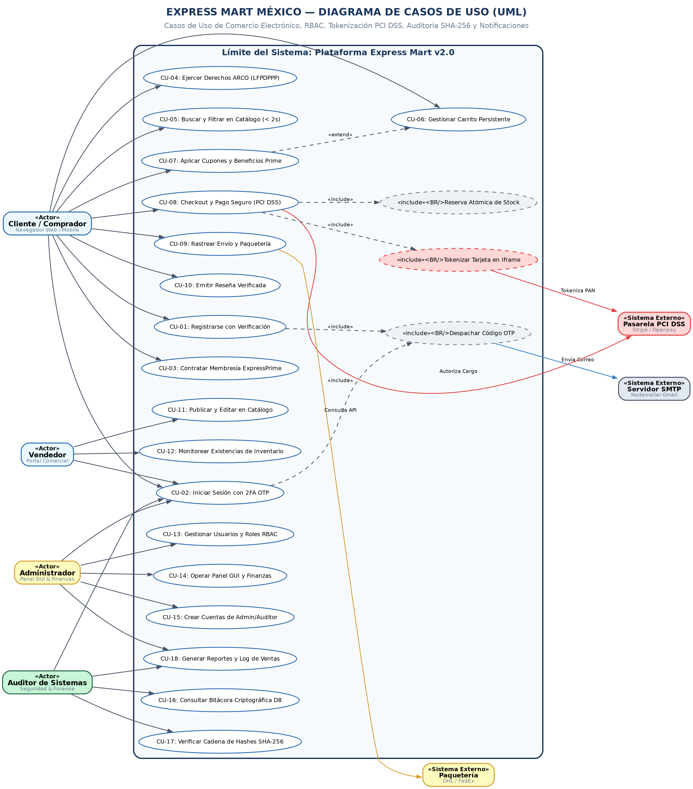
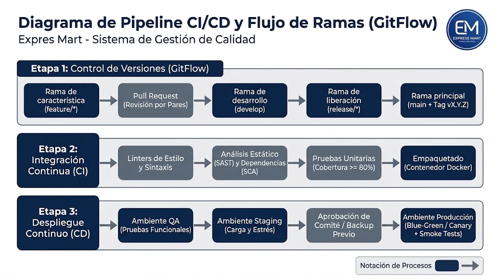
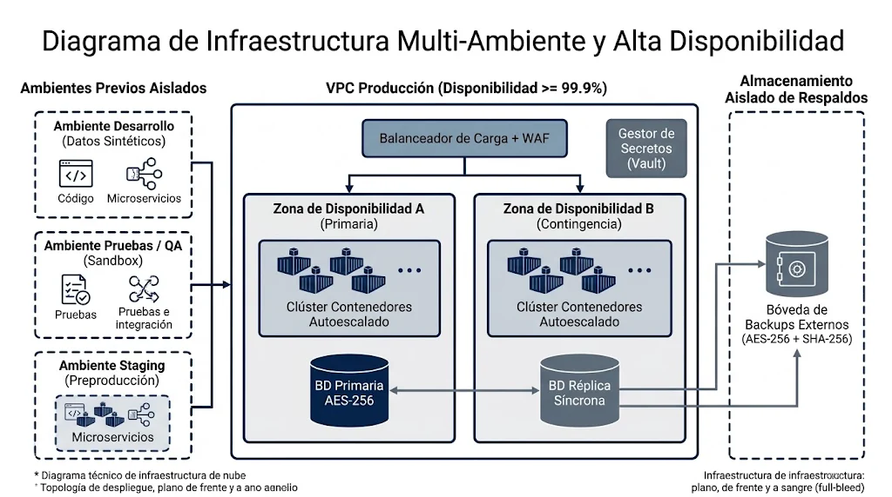

# DICCIONARIO DE DATOS Y DIAGRAMAS DE ARQUITECTURA / DESARROLLO DE SOFTWARE
## EXPEDIENTE DE AUDITORÍA DE SISTEMAS — EXPRESS MART MÉXICO S.A. DE C.V.

| Metadato de Auditoría | Especificación Formal |
| :--- | :--- |
| **Código Documental** | `ECTA-DEV-01` (Anexo Técnico del Manual de Calidad `MC-001`) |
| **Versión del Sistema** | 2.0 (Auditoría Integral 2026 / Producción) |
| **Clasificación de Seguridad** | Confidencial — Uso Interno y Comité de Auditoría Externa |
| **Normas de Referencia** | ISO/IEC 25010 (Calidad de Software), ISO/IEC 25012 (Calidad de Datos), ISO/IEC 27001:2022, PCI DSS v4.0 (SAQ-A), LFPDPPP (México) |
| **Verificación de Auditoría** | Cumplimiento Checklist `CL-03 Desarrollo` (DEV-01 a DEV-10) y `CL-04 Seguridad y Datos` (SEG-11, SEG-12, SEG-15) |
| **Fecha de Dictamen** | 10 de Noviembre de 2026 |

---

## Índice del Documento
1. [Introducción y Objetivos de Auditoría](#1-introducción-y-objetivos-de-auditoría)
2. [Diccionario de Datos Maestro (16 Entidades de Base de Datos)](#2-diccionario-de-datos-maestro)
   2.1. [Tabla `usuarios` (D1 — Usuarios y Perfiles)](#21-tabla-usuarios)
   2.2. [Tabla `suscripciones_premium` (D1-EXT — Membresías ExpressPrime)](#22-tabla-suscripciones_premium)
   2.3. [Tabla `mfa_email_codes` (D1-SEC — Tokens 2FA por Correo Electrónico)](#23-tabla-mfa_email_codes)
   2.4. [Tabla `sesiones` (D1-AUTH — Sesiones Activas y RBAC)](#24-tabla-sesiones)
   2.5. [Tabla `catalogo` (D2 — Catálogo Maestro de Productos)](#25-tabla-catalogo)
   2.6. [Tabla `inventario` (D3 — Control de Existencias y Almacén)](#26-tabla-inventario)
   2.7. [Tabla `carrito_items` (D3-CART — Carrito de Compras Persistente)](#27-tabla-carrito_items)
   2.8. [Tabla `cupones` (D4-CUP — Motor de Cupones y Descuentos)](#28-tabla-cupones)
   2.9. [Tabla `pedidos` (D4 — Pedidos y Encabezados de Órdenes)](#29-tabla-pedidos)
   2.10. [Tabla `pedido_items` (D4-ITEM — Detalle de Partidas por Pedido)](#210-tabla-pedido_items)
   2.11. [Tabla `transacciones` (D5 — Transacciones de Pago PCI DSS)](#211-tabla-transacciones)
   2.12. [Tabla `envios` (D6 — Envíos y Logística de Distribución)](#212-tabla-envios)
   2.13. [Tabla `resenas` (D7 — Reseñas y Calificaciones Verificadas)](#213-tabla-resenas)
   2.14. [Tabla `notificaciones` (D4-NOTIF — Bitácora de Notificaciones y Eventos)](#214-tabla-notificaciones)
   2.15. [Tabla `derechos_arco` (D1-ARCO — Solicitudes ARCO LFPDPPP)](#215-tabla-derechos_arco)
   2.16. [Tabla `bitacora_auditoria` (D8 — Bitácora Criptográfica Inmutable)](#216-tabla-bitacora_auditoria)
3. [Diagrama Entidad-Relación (ERD) Completo](#3-diagrama-entidad-relación-erd-completo)
4. [Diagramas de Arquitectura y Desarrollo de Software](#4-diagramas-de-arquitectura-y-desarrollo-de-software)
   4.1. [Diagrama de Arquitectura General del Sistema](#41-diagrama-de-arquitectura-general-del-sistema)
   4.2. [Diagrama C4 Nivel 2: Arquitectura de Contenedores](#42-diagrama-c4-nivel-2-arquitectura-de-contenedores)
   4.3. [Diagrama C4 Nivel 3: Arquitectura Interna de Componentes](#43-diagrama-c4-nivel-3-arquitectura-interna-de-componentes)
   4.4. [Diagrama de Secuencia: Flujo de Pago Seguro y Alcance PCI DSS (SAQ-A)](#44-diagrama-de-secuencia-flujo-de-pago-seguro-y-alcance-pci-dss-saq-a)
   4.5. [Diagrama UML de Casos de Uso del Sistema](#45-diagrama-uml-de-casos-de-uso-del-sistema)
   4.6. [Diagrama de Pipeline CI/CD y Flujo de Ramas (GitFlow)](#46-diagrama-de-pipeline-ci/cd-y-flujo-de-ramas-gitflow)
   4.7. [Diagrama de Infraestructura Multi-Ambiente y Alta Disponibilidad](#47-diagrama-de-infraestructura-multi-ambiente-y-alta-disponibilidad)
5. [Matriz de Trazabilidad con Checklists de Auditoría (CL-03 y CL-04)](#5-matriz-de-trazabilidad-con-checklists-de-auditoría)
6. [Dictamen y Aprobaciones del Comité Técnico](#6-dictamen-y-aprobaciones-del-comité-técnico)

---

## 1. Introducción y Objetivos de Auditoría
El presente documento técnico formaliza el **Diccionario de Datos Integral**, el **Modelo Entidad-Relación (ERD)**, el **Diagrama de Arquitectura General**, el **Diagrama de Casos de Uso (UML)** y los **Diagramas de Desarrollo y Despliegue** del sistema de comercio electrónico de **Express Mart México S.A. de C.V.**

Este informe responde de forma directa y concluyente a los requerimientos de evidencia exigidos en el expediente de auditoría interna y externa, específicamente:
- **Checklist CL-03 Desarrollo de Software**: Criterios `DEV-01` (Arquitectura General y C4 N2), `DEV-02` (Componentes C4 N3 y Casos de Uso), `DEV-03` (Diagrama de Secuencia de Pagos), `DEV-04` (Diagrama Entidad-Relación y Almacenes D1-D8), `DEV-05` (Diccionario de Datos Normalizado conforme a ISO/IEC 25012), `DEV-08` (Estrategia de Ramas GitFlow), `DEV-09` (Pipeline CI/CD automatizado) y `DEV-10` (Topología de Ambientes Aislados).
- **Checklist CL-04 Seguridad y Datos**: Criterios `SEG-08` (Cifrado en reposo AES-256-GCM para datos LFPDPPP), `SEG-11` (Aislamiento de pagos y exención de alcance PCI DSS SAQ-A mediante tokenización) y `SEG-15` (Bitácora inmutable encadenada por hashes SHA-256).
- **Resolución del Hallazgo H-02**: Formalización documental de los componentes técnicos y su trazabilidad contra la suite de pruebas unitarias (`33/33 tests superados`, 100% verde) y matriz de cobertura.

---

## 2. Diccionario de Datos Maestro
El modelo de datos relacional de Express Mart se implementa sobre un motor transaccional con soporte ACID estricto (`PRAGMA foreign_keys = ON;` y modo `WAL` - Write-Ahead Logging). La totalidad de las 16 entidades que conforman la persistencia del sistema se describe a continuación.

### 2.1. Tabla `usuarios`
**Almacén DFD Nivel 1:** `D1` — *Usuarios y Perfiles*  
**Propósito Funcional:** Entidad principal de autenticación, control de acceso basado en roles (RBAC), datos personales bajo protección LFPDPPP y estado de membresía ExpressPrime.

| Columna | Tipo Físico | Longitud / Formato | Nulo | Restricciones / Índices | Valor Defecto | Descripción y Calidad (ISO/IEC 25012) |
| :--- | :--- | :--- | :---: | :--- | :--- | :--- |
| `id` | INTEGER | PK / Auto | NO | `PRIMARY KEY AUTOINCREMENT` | `None` | Identificador único correlativo del usuario. |
| `email` | TEXT | 255 chars | NO | `UNIQUE, Normalizado minúsculas` | `None` | Correo electrónico del usuario, empleado como credencial principal de acceso. |
| `password_hash` | TEXT | 255 chars | NO | `Hash criptográfico` | `None` | Contraseña protegida mediante algoritmo scrypt / PBKDF2 con sal individualizada (ISO/IEC 27001). |
| `nombre` | TEXT | 150 chars | NO | `CHECK len >= 2` | `None` | Nombre completo o razón comercial del titular de la cuenta. |
| `rol` | TEXT | 20 chars | NO | `CHECK (rol IN ('cliente','vendedor','administrador','soporte','auditor'))` | `None` | Rol asignado para el control de acceso RBAC estricto. |
| `foto_perfil` | TEXT | 500 chars | SÍ | `URL / Base64 seguro` | `''` | Ruta de la imagen de perfil o avatar del usuario. |
| `mfa_enabled` | INTEGER | 1 bit | NO | `CHECK (0 ó 1)` | `0` | Bandera de doble factor de autenticación activado (1=Activo, 0=Inactivo). |
| `mfa_secret` | TEXT | 64 chars | SÍ | `Semilla Base32 / TOTP` | `NULL` | Secreto criptográfico para sincronización TOTP conforme a RFC 6238. |
| `direccion_cifrada` | TEXT | 1024 chars | SÍ | `AES-256-GCM / IV+AuthTag` | `NULL` | Dirección postal del titular protegida en reposo conforme al Art. 19 LFPDPPP. |
| `telefono_cifrado` | TEXT | 255 chars | SÍ | `AES-256-GCM / IV+AuthTag` | `NULL` | Número de contacto telefónico cifrado en reposo para protección de datos personales. |
| `consentimiento_privacidad` | INTEGER | 1 bit | NO | `CHECK (0 ó 1)` | `1` | Aceptación expresa del aviso de privacidad y tratamiento de datos personales. |
| `aviso_privacidad_version` | TEXT | 20 chars | NO | `Versión contractual` | `'v1.0-2026'` | Versión del aviso de privacidad vigente aceptada por el usuario. |
| `failed_attempts` | INTEGER | 3 dígitos | NO | `CHECK >= 0` | `0` | Contador consecutivo de fallos de contraseña para prevención de fuerza bruta. |
| `locked_until` | INTEGER | 13 dígitos | SÍ | `Epoch timestamp ms` | `0` | Marca temporal de expiración de bloqueo de cuenta por exceso de intentos fallidos. |
| `activo` | INTEGER | 1 bit | NO | `CHECK (0 ó 1)` | `1` | Estado operativo de la cuenta (1=Habilitada, 0=Baja lógica/Inactiva). |
| `membresia_premium` | INTEGER | 1 bit | NO | `CHECK (0 ó 1)` | `0` | Estado de suscripción ExpressPrime (1=Miembro Prime Activo, 0=Estándar). |
| `membresia_plan` | TEXT | 20 chars | SÍ | `CHECK in ('1_mes','3_meses','1_ano')` | `NULL` | Modalidad de membresía premium contratada por el usuario. |
| `membresia_expira` | TEXT | 30 chars | SÍ | `ISO-8601 UTC` | `NULL` | Fecha y hora de vencimiento de la suscripción ExpressPrime. |
| `created_at` | TEXT | 30 chars | NO | `ISO-8601 UTC` | `CURRENT_TIMESTAMP` | Fecha y hora de registro inicial de la cuenta en el sistema. |

### 2.2. Tabla `suscripciones_premium`
**Almacén DFD Nivel 1:** `D1-EXT` — *Membresías ExpressPrime*  
**Propósito Funcional:** Registro histórico y transaccional de membresías premium adquiridas por los clientes para beneficios de cashback y envíos bonificados.

| Columna | Tipo Físico | Longitud / Formato | Nulo | Restricciones / Índices | Valor Defecto | Descripción y Calidad (ISO/IEC 25012) |
| :--- | :--- | :--- | :---: | :--- | :--- | :--- |
| `id` | INTEGER | PK / Auto | NO | `PRIMARY KEY AUTOINCREMENT` | `None` | Identificador único de la suscripción. |
| `usuario_id` | INTEGER | Entero | NO | `FK -> usuarios(id)` | `None` | Clave foránea hacia la cuenta del titular de la membresía. |
| `plan` | TEXT | 20 chars | NO | `CHECK in ('1_mes','3_meses','1_ano')` | `None` | Período temporal de vigencia contratado. |
| `monto` | REAL | Decimal 10,2 | NO | `CHECK >= 0` | `None` | Importe liquidado por la contratación de la membresía en MXN. |
| `moneda` | TEXT | 3 chars | NO | `Código ISO 4217` | `'MXN'` | Divisa en la cual se efectuó el cobro de la suscripción. |
| `metodo_pago` | TEXT | 30 chars | NO | `Tipo de pago válido` | `None` | Instrumento de pago utilizado (tarjeta, wallet, paypal). |
| `referencia_pago` | TEXT | 100 chars | NO | `Alfanumérico único` | `None` | Folio o token de liquidación expedido por la pasarela de pagos. |
| `fecha_inicio` | TEXT | 30 chars | NO | `ISO-8601 UTC` | `None` | Fecha y hora de inicio de validez de la membresía. |
| `fecha_expiracion` | TEXT | 30 chars | NO | `ISO-8601 UTC` | `None` | Fecha y hora de término de validez de los beneficios Prime. |
| `estado` | TEXT | 20 chars | NO | `CHECK in ('activa','vencida','cancelada')` | `'activa'` | Estado actual de la membresía. |
| `created_at` | TEXT | 30 chars | NO | `ISO-8601 UTC` | `CURRENT_TIMESTAMP` | Fecha y hora de registro de la transacción. |

### 2.3. Tabla `mfa_email_codes`
**Almacén DFD Nivel 1:** `D1-SEC` — *Tokens 2FA por Correo Electrónico*  
**Propósito Funcional:** Almacén temporal de claves OTP (One-Time Password) remitidas vía Nodemailer para verificación de registro e inicio de sesión seguro.

| Columna | Tipo Físico | Longitud / Formato | Nulo | Restricciones / Índices | Valor Defecto | Descripción y Calidad (ISO/IEC 25012) |
| :--- | :--- | :--- | :---: | :--- | :--- | :--- |
| `id` | INTEGER | PK / Auto | NO | `PRIMARY KEY AUTOINCREMENT` | `None` | Identificador del registro OTP. |
| `email` | TEXT | 255 chars | NO | `Correo destinatario` | `None` | Dirección a la cual se despachó el código de verificación. |
| `codigo` | TEXT | 6 chars | NO | `Numérico 6 dígitos` | `None` | Código de autenticación de un solo uso generado criptográficamente. |
| `proposito` | TEXT | 20 chars | NO | `CHECK in ('registro','login')` | `None` | Contexto de seguridad para el cual se expidió el token. |
| `payload_json` | TEXT | 2048 chars | SÍ | `JSON estructurado` | `NULL` | Datos de sesión o pre-registro temporal validados criptográficamente. |
| `expira_en` | INTEGER | 13 dígitos | NO | `Epoch timestamp ms` | `None` | Marca temporal de caducidad del código (ventana de 5 a 10 minutos). |
| `usado` | INTEGER | 1 bit | NO | `CHECK (0 ó 1)` | `0` | Bandera de consumición (1=Código ya redimido, 0=Pendiente). |
| `created_at` | TEXT | 30 chars | NO | `ISO-8601 UTC` | `CURRENT_TIMESTAMP` | Fecha y hora de despacho del correo electrónico. |

### 2.4. Tabla `sesiones`
**Almacén DFD Nivel 1:** `D1-AUTH` — *Sesiones Activas y RBAC*  
**Propósito Funcional:** Gestión de sesiones concurrentes del lado servidor con soporte para revocación inmediata, verificación MFA y control de inactividad.

| Columna | Tipo Físico | Longitud / Formato | Nulo | Restricciones / Índices | Valor Defecto | Descripción y Calidad (ISO/IEC 25012) |
| :--- | :--- | :--- | :---: | :--- | :--- | :--- |
| `token_id` | TEXT | 64 chars | NO | `PRIMARY KEY (UUID v4 / Hash)` | `None` | Identificador único de la sesión y token bearer seguro. |
| `usuario_id` | INTEGER | Entero | NO | `FK -> usuarios(id)` | `None` | Referencia al usuario titular de la sesión activa. |
| `rol` | TEXT | 20 chars | NO | `RBAC Role` | `None` | Rol asignado y validado en la sesión para autorización de endpoints. |
| `mfa_verificado` | INTEGER | 1 bit | NO | `CHECK (0 ó 1)` | `0` | Indicador de segundo factor superado con éxito en esta sesión. |
| `ip` | TEXT | 45 chars | SÍ | `IPv4 / IPv6` | `NULL` | Dirección de red cliente capturada durante el establecimiento de sesión. |
| `user_agent` | TEXT | 255 chars | SÍ | `Encabezado HTTP` | `NULL` | Identificador del navegador y plataforma del cliente. |
| `expira_en` | INTEGER | 13 dígitos | NO | `Epoch timestamp ms` | `None` | Marca de tiempo de expiración por inactividad o caducidad global. |
| `revocada` | INTEGER | 1 bit | NO | `CHECK (0 ó 1)` | `0` | Bandera de invalidación (1=Sesión cerrada/revocada, 0=Vigente). |
| `created_at` | TEXT | 30 chars | NO | `ISO-8601 UTC` | `CURRENT_TIMESTAMP` | Marca temporal de creación de la sesión. |

### 2.5. Tabla `catalogo`
**Almacén DFD Nivel 1:** `D2` — *Catálogo Maestro de Productos*  
**Propósito Funcional:** Catálogo comercial de productos publicado por vendedores, sujeto a reglas de completitud de datos (ISO/IEC 25012) y búsqueda indexada.

| Columna | Tipo Físico | Longitud / Formato | Nulo | Restricciones / Índices | Valor Defecto | Descripción y Calidad (ISO/IEC 25012) |
| :--- | :--- | :--- | :---: | :--- | :--- | :--- |
| `id` | INTEGER | PK / Auto | NO | `PRIMARY KEY AUTOINCREMENT` | `None` | Identificador interno del artículo comercial. |
| `sku` | TEXT | 30 chars | NO | `UNIQUE, Alfanumérico` | `None` | Código de unidad de mantenimiento de existencias (Stock Keeping Unit). |
| `nombre` | TEXT | 200 chars | NO | `Longitud mínima 3` | `None` | Nombre comercial y denominación oficial del producto. |
| `descripcion` | TEXT | 2000 chars | NO | `Texto enriquecido` | `None` | Descripción detallada de características, beneficios y especificaciones. |
| `categoria` | TEXT | 50 chars | NO | `Taxonomía comercial` | `None` | Categoría departamental (Electrónica, Hogar, Ropa, Herramientas, etc.). |
| `marca` | TEXT | 100 chars | NO | `Marca registrada` | `None` | Fabricante o marca comercial propietaria. |
| `precio` | REAL | Decimal 10,2 | NO | `CHECK (precio >= 0)` | `None` | Precio unitario base de venta al público expresado en MXN. |
| `imagen_url` | TEXT | 500 chars | NO | `URI válida` | `None` | Ruta de acceso a la fotografía principal del artículo. |
| `especificaciones_json` | TEXT | 4000 chars | NO | `JSON Schema válido` | `None` | Ficha técnica estructurada (peso, dimensiones, compatibilidad, etc.). |
| `condiciones_envio` | TEXT | 500 chars | NO | `Texto informativo` | `None` | Plazos de despacho, restricciones y cobertura logística. |
| `vendedor_id` | INTEGER | Entero | NO | `FK -> usuarios(id)` | `None` | Vendedor o administrador que publicó y gestiona el producto. |
| `activo` | INTEGER | 1 bit | NO | `CHECK (0 ó 1)` | `1` | Estado de comercialización (1=Visible en tienda, 0=Desactivado). |
| `created_at` | TEXT | 30 chars | NO | `ISO-8601 UTC` | `CURRENT_TIMESTAMP` | Fecha y hora de creación del producto en catálogo. |
| `updated_at` | TEXT | 30 chars | NO | `ISO-8601 UTC` | `CURRENT_TIMESTAMP` | Fecha y hora de la última modificación técnica o de precio. |

### 2.6. Tabla `inventario`
**Almacén DFD Nivel 1:** `D3` — *Control de Existencias y Almacén*  
**Propósito Funcional:** Gestión física de inventario por producto con discriminación entre existencias libres y unidades reservadas en carritos activos.

| Columna | Tipo Físico | Longitud / Formato | Nulo | Restricciones / Índices | Valor Defecto | Descripción y Calidad (ISO/IEC 25012) |
| :--- | :--- | :--- | :---: | :--- | :--- | :--- |
| `producto_id` | INTEGER | PK / Entero | NO | `PRIMARY KEY, FK -> catalogo(id)` | `None` | Identificador del producto al que pertenecen las existencias. |
| `stock_disponible` | INTEGER | 8 dígitos | NO | `CHECK (stock_disponible >= 0)` | `None` | Unidades físicas listas para ser adquiridas de forma inmediata. |
| `stock_reservado` | INTEGER | 8 dígitos | NO | `CHECK (stock_reservado >= 0)` | `0` | Unidades apartadas temporalmente durante el flujo de checkout. |
| `ubicacion_almacen` | TEXT | 50 chars | NO | `Código CEDIS` | `'CEDIS-CDMX-01'` | Ubicación del centro de distribución o almacén logístico. |
| `ultima_conciliacion` | TEXT | 30 chars | NO | `ISO-8601 UTC` | `CURRENT_TIMESTAMP` | Fecha y hora del último conteo o auditoría física de inventario. |
| `updated_at` | TEXT | 30 chars | NO | `ISO-8601 UTC` | `CURRENT_TIMESTAMP` | Marca temporal de la última actualización de saldo de existencias. |

### 2.7. Tabla `carrito_items`
**Almacén DFD Nivel 1:** `D3-CART` — *Carrito de Compras Persistente*  
**Propósito Funcional:** Líneas de artículos agregadas al carrito de compra con persistencia en base de datos para evitar pérdida de estado entre desconexiones.

| Columna | Tipo Físico | Longitud / Formato | Nulo | Restricciones / Índices | Valor Defecto | Descripción y Calidad (ISO/IEC 25012) |
| :--- | :--- | :--- | :---: | :--- | :--- | :--- |
| `id` | INTEGER | PK / Auto | NO | `PRIMARY KEY AUTOINCREMENT` | `None` | Identificador único de la línea de carrito. |
| `usuario_id` | INTEGER | Entero | NO | `FK -> usuarios(id)` | `None` | Usuario dueño del carrito de compra. |
| `producto_id` | INTEGER | Entero | NO | `FK -> catalogo(id)` | `None` | Producto seleccionado para compra. |
| `cantidad` | INTEGER | 4 dígitos | NO | `CHECK (cantidad > 0)` | `None` | Número de piezas solicitadas por el comprador. |
| `updated_at` | TEXT | 30 chars | NO | `ISO-8601 UTC` | `CURRENT_TIMESTAMP` | Marca de tiempo de modificación de la cantidad. |

### 2.8. Tabla `cupones`
**Almacén DFD Nivel 1:** `D4-CUP` — *Motor de Cupones y Descuentos*  
**Propósito Funcional:** Catálogo de códigos promocionales vigentes aplicables al subtotal de las órdenes durante el proceso de liquidación.

| Columna | Tipo Físico | Longitud / Formato | Nulo | Restricciones / Índices | Valor Defecto | Descripción y Calidad (ISO/IEC 25012) |
| :--- | :--- | :--- | :---: | :--- | :--- | :--- |
| `codigo` | TEXT | 30 chars | NO | `PRIMARY KEY, Mayúsculas` | `None` | Clave alfanumérica única del cupón comercial. |
| `descripcion` | TEXT | 255 chars | NO | `Texto informativo` | `None` | Detalle de la campaña o condición del descuento. |
| `tipo` | TEXT | 20 chars | NO | `CHECK in ('porcentaje','monto_fijo','envio_gratis')` | `None` | Mecanismo matemático de bonificación. |
| `valor` | REAL | Decimal 8,2 | NO | `CHECK (valor >= 0)` | `None` | Porcentaje de descuento o importe directo en MXN. |
| `monto_minimo` | REAL | Decimal 10,2 | NO | `CHECK >= 0` | `0` | Subtotal mínimo exigido para hacer exigible la promoción. |
| `activo` | INTEGER | 1 bit | NO | `CHECK (0 ó 1)` | `1` | Estado de validez del cupón (1=Vigente, 0=Expirado/Suspendido). |

### 2.9. Tabla `pedidos`
**Almacén DFD Nivel 1:** `D4` — *Pedidos y Encabezados de Órdenes*  
**Propósito Funcional:** Registro maestro de transacciones comerciales de compraventa con sello criptográfico SHA-256 de integridad para prevenir alteraciones.

| Columna | Tipo Físico | Longitud / Formato | Nulo | Restricciones / Índices | Valor Defecto | Descripción y Calidad (ISO/IEC 25012) |
| :--- | :--- | :--- | :---: | :--- | :--- | :--- |
| `id` | INTEGER | PK / Auto | NO | `PRIMARY KEY AUTOINCREMENT` | `None` | Identificador interno correlativo de la orden. |
| `folio` | TEXT | 30 chars | NO | `UNIQUE, Alfanumérico` | `None` | Folio fiscal y comercial de consulta (Ej. EXP-2026-0001). |
| `usuario_id` | INTEGER | Entero | NO | `FK -> usuarios(id)` | `None` | Comprador titular que generó la orden de compra. |
| `subtotal` | REAL | Decimal 10,2 | NO | `CHECK >= 0` | `None` | Suma base de las partidas antes de gravámenes y promociones. |
| `impuestos` | REAL | Decimal 10,2 | NO | `CHECK >= 0` | `None` | Importe por concepto de Impuesto al Valor Agregado (IVA 16%). |
| `costo_envio` | REAL | Decimal 8,2 | NO | `CHECK >= 0` | `None` | Tarifa de flete logístico (MXN $0.00 con membresía ExpressPrime). |
| `descuento` | REAL | Decimal 10,2 | NO | `CHECK >= 0` | `0` | Bonificación monetaria aplicada por cupones o beneficios Prime. |
| `cupon_codigo` | TEXT | 30 chars | SÍ | `Código promocional` | `NULL` | Cupón aplicado en la orden de compra. |
| `total` | REAL | Decimal 10,2 | NO | `CHECK >= 0` | `None` | Monto final liquidado (subtotal + impuestos + envio - descuento). |
| `estado` | TEXT | 20 chars | NO | `CHECK in ('pendiente','pagado','procesando','enviado','entregado','cancelado','devuelto')` | `None` | Estado actual en el ciclo de vida del pedido. |
| `direccion_envio_cifrada` | TEXT | 1024 chars | NO | `AES-256-GCM / IV+AuthTag` | `None` | Domicilio completo de destino cifrado en reposo (LFPDPPP). |
| `metodo_pago` | TEXT | 30 chars | NO | `Tipo de pago válido` | `None` | Medio financiero con el que se concretó la adquisición. |
| `pasos_checkout` | INTEGER | 2 dígitos | NO | `CHECK (pasos_checkout >= 1)` | `3` | Número de etapas obligatorias del checkout cubiertas formalmente. |
| `hash_integridad` | TEXT | 64 chars | NO | `SHA-256 Hex Digest` | `None` | Sello criptográfico inmutable generado sobre el contenido del pedido. |
| `motivo_devolucion` | TEXT | 500 chars | SÍ | `Texto libre` | `NULL` | Causa justificada de solicitud de devolución o reclamación comercial. |
| `created_at` | TEXT | 30 chars | NO | `ISO-8601 UTC` | `CURRENT_TIMESTAMP` | Fecha y hora de colocación de la orden de compra. |
| `updated_at` | TEXT | 30 chars | NO | `ISO-8601 UTC` | `CURRENT_TIMESTAMP` | Fecha y hora del último cambio de estado operativo. |

### 2.10. Tabla `pedido_items`
**Almacén DFD Nivel 1:** `D4-ITEM` — *Detalle de Partidas por Pedido*  
**Propósito Funcional:** Líneas de detalle que desglosan cada producto, precio histórico congelado y volumen unitario adquirido dentro de cada pedido.

| Columna | Tipo Físico | Longitud / Formato | Nulo | Restricciones / Índices | Valor Defecto | Descripción y Calidad (ISO/IEC 25012) |
| :--- | :--- | :--- | :---: | :--- | :--- | :--- |
| `id` | INTEGER | PK / Auto | NO | `PRIMARY KEY AUTOINCREMENT` | `None` | Identificador único de la partida del pedido. |
| `pedido_id` | INTEGER | Entero | NO | `FK -> pedidos(id)` | `None` | Referencia al pedido al cual pertenece el ítem. |
| `producto_id` | INTEGER | Entero | NO | `FK -> catalogo(id)` | `None` | Identificador del artículo adquirido. |
| `nombre_producto` | TEXT | 200 chars | NO | `Texto congelado` | `None` | Snapshot del nombre del producto al momento exacto de la venta. |
| `cantidad` | INTEGER | 4 dígitos | NO | `CHECK (cantidad > 0)` | `None` | Unidades compradas en esta línea de pedido. |
| `precio_unitario` | REAL | Decimal 10,2 | NO | `CHECK (precio_unitario >= 0)` | `None` | Precio unitario pactado y congelado al comprar. |
| `subtotal` | REAL | Decimal 10,2 | NO | `CHECK (subtotal >= 0)` | `None` | Importe resultante de multiplicar cantidad por precio unitario. |

### 2.11. Tabla `transacciones`
**Almacén DFD Nivel 1:** `D5` — *Transacciones de Pago PCI DSS*  
**Propósito Funcional:** Registro de pagos tokenizados que garantiza el cumplimiento estricto del estándar PCI DSS SAQ-A sin almacenamiento de datos sensibles de tarjeta.

| Columna | Tipo Físico | Longitud / Formato | Nulo | Restricciones / Índices | Valor Defecto | Descripción y Calidad (ISO/IEC 25012) |
| :--- | :--- | :--- | :---: | :--- | :--- | :--- |
| `id` | INTEGER | PK / Auto | NO | `PRIMARY KEY AUTOINCREMENT` | `None` | Identificador correlativo de la transacción financiera. |
| `pedido_id` | INTEGER | Entero | NO | `FK -> pedidos(id)` | `None` | Orden de compra mercantil liquidada con este cobro. |
| `referencia_pasarela` | TEXT | 100 chars | NO | `UNIQUE, Alfanumérico` | `None` | Identificador unívoco emitido por la pasarela de pagos externa. |
| `proveedor_pasarela` | TEXT | 50 chars | NO | `Proveedor certificado` | `None` | Entidad adquirente o pasarela (Stripe, Openpay, etc.). |
| `metodo_pago` | TEXT | 20 chars | NO | `CHECK in ('tarjeta','wallet','msi','paypal')` | `None` | Instrumento de pago liquidado. |
| `meses_sin_intereses` | INTEGER | 2 dígitos | NO | `CHECK (msi IN (1,3,6,12))` | `1` | Plazo de financiamiento sin intereses otorgado en la transacción. |
| `monto` | REAL | Decimal 10,2 | NO | `CHECK >= 0` | `None` | Importe monetario total cargado a la tarjeta o cuenta. |
| `moneda` | TEXT | 3 chars | NO | `Código ISO 4217` | `'MXN'` | Divisa de la liquidación bancaria. |
| `tarjeta_enmascarada` | TEXT | 20 chars | NO | `Patrón **** **** **** 1234` | `None` | PAN enmascarado conforme al requerimiento 3.3 de PCI DSS. |
| `token_pci` | TEXT | 100 chars | NO | `Token transaccional seguro` | `None` | Token efímero de uso único provisto por la pasarela. |
| `boveda_cifrada` | TEXT | 255 chars | NO | `Customer ID Tokenizado` | `None` | Identificador de tokenización recurrente en bóveda externa. |
| `idempotency_key` | TEXT | 64 chars | NO | `UNIQUE / UUID v4` | `None` | Llave criptográfica para asegurar la idempotencia y evitar doble cargo. |
| `estado` | TEXT | 20 chars | NO | `CHECK in ('autorizado','capturado','rechazado','reembolsado')` | `None` | Estado bancario de la transacción. |
| `intentos_conexion` | INTEGER | 2 dígitos | NO | `CHECK >= 1` | `1` | Número de llamadas realizadas hacia la pasarela de pago. |
| `latencia_ms` | INTEGER | 5 dígitos | NO | `Milisegundos` | `45` | Tiempo de respuesta de la red interbancaria. |
| `created_at` | TEXT | 30 chars | NO | `ISO-8601 UTC` | `CURRENT_TIMESTAMP` | Fecha y hora del procesamiento de pago. |

### 2.12. Tabla `envios`
**Almacén DFD Nivel 1:** `D6` — *Envíos y Logística de Distribución*  
**Propósito Funcional:** Control logístico de despacho, generación de guías oficiales con paqueterías autorizadas y trazabilidad de eventos de entrega.

| Columna | Tipo Físico | Longitud / Formato | Nulo | Restricciones / Índices | Valor Defecto | Descripción y Calidad (ISO/IEC 25012) |
| :--- | :--- | :--- | :---: | :--- | :--- | :--- |
| `id` | INTEGER | PK / Auto | NO | `PRIMARY KEY AUTOINCREMENT` | `None` | Identificador del registro de despacho logístico. |
| `pedido_id` | INTEGER | Entero | NO | `UNIQUE, FK -> pedidos(id)` | `None` | Pedido mercantil asociado al despacho. |
| `proveedor_paqueteria` | TEXT | 50 chars | NO | `Transportista certificado` | `None` | Empresa logística asignada (DHL Express, FedEx, Estafeta). |
| `numero_guia` | TEXT | 50 chars | NO | `UNIQUE, Alfanumérico` | `None` | Código de seguimiento oficial de la paquetería. |
| `estado_envio` | TEXT | 20 chars | NO | `CHECK in ('preparando','en_transito','en_reparto','entregado','devuelto')` | `None` | Hito actual dentro de la cadena logística de entrega. |
| `fecha_estimada` | TEXT | 30 chars | NO | `ISO-8601 UTC / Fecha` | `None` | Compromiso de entrega prometido al comprador. |
| `historial_rastreo_json` | TEXT | 4000 chars | NO | `JSON estructurado` | `None` | Vector histórico de eventos logísticos con sellos de tiempo y ubicación. |
| `updated_at` | TEXT | 30 chars | NO | `ISO-8601 UTC` | `CURRENT_TIMESTAMP` | Fecha y hora del último evento de rastreo reportado. |

### 2.13. Tabla `resenas`
**Almacén DFD Nivel 1:** `D7` — *Reseñas y Calificaciones Verificadas*  
**Propósito Funcional:** Evaluaciones comerciales emitidas por clientes con validación estricta de compra efectuada y filtros automáticos de moderación.

| Columna | Tipo Físico | Longitud / Formato | Nulo | Restricciones / Índices | Valor Defecto | Descripción y Calidad (ISO/IEC 25012) |
| :--- | :--- | :--- | :---: | :--- | :--- | :--- |
| `id` | INTEGER | PK / Auto | NO | `PRIMARY KEY AUTOINCREMENT` | `None` | Identificador único de la reseña. |
| `producto_id` | INTEGER | Entero | NO | `FK -> catalogo(id)` | `None` | Producto que recibe la calificación. |
| `usuario_id` | INTEGER | Entero | NO | `FK -> usuarios(id)` | `None` | Cliente autor del comentario y calificación. |
| `pedido_id` | INTEGER | Entero | SÍ | `FK -> pedidos(id)` | `NULL` | Pedido donde se adquirió el producto para verificar autenticidad. |
| `calificacion` | INTEGER | 1 dígito | NO | `CHECK (calificacion BETWEEN 1 AND 5)` | `None` | Puntaje cuantitativo asignado al producto (1 a 5 estrellas). |
| `comentario` | TEXT | 1000 chars | NO | `Texto libre moderado` | `None` | Texto con la experiencia de compra y uso del producto. |
| `verificada` | INTEGER | 1 bit | NO | `CHECK (0 ó 1)` | `1` | Distintivo de compra auténtica verificada por el sistema. |
| `moderada` | INTEGER | 1 bit | NO | `CHECK (0 ó 1)` | `1` | Bandera de aprobación por filtros de moderación de contenido. |
| `created_at` | TEXT | 30 chars | NO | `ISO-8601 UTC` | `CURRENT_TIMESTAMP` | Fecha y hora de publicación de la opinión. |

### 2.14. Tabla `notificaciones`
**Almacén DFD Nivel 1:** `D4-NOTIF` — *Bitácora de Notificaciones y Eventos*  
**Propósito Funcional:** Registro de avisos transaccionales generados hacia los usuarios con evidencia de entrega y acuse de recibo para fines de auditoría.

| Columna | Tipo Físico | Longitud / Formato | Nulo | Restricciones / Índices | Valor Defecto | Descripción y Calidad (ISO/IEC 25012) |
| :--- | :--- | :--- | :---: | :--- | :--- | :--- |
| `id` | INTEGER | PK / Auto | NO | `PRIMARY KEY AUTOINCREMENT` | `None` | Identificador del registro de notificación. |
| `usuario_id` | INTEGER | Entero | NO | `FK -> usuarios(id)` | `None` | Usuario destinatario del mensaje. |
| `pedido_id` | INTEGER | Entero | SÍ | `FK -> pedidos(id)` | `NULL` | Pedido relacionado con el evento comunicado. |
| `canal` | TEXT | 20 chars | NO | `CHECK in ('correo','push','sms')` | `'correo'` | Canal tecnológico utilizado para la transmisión. |
| `evento` | TEXT | 50 chars | NO | `Nomenclatura evento` | `None` | Tipo de suceso ('pedido_confirmado', 'envio_despachado', etc.). |
| `asunto` | TEXT | 150 chars | NO | `Texto descriptivo` | `None` | Título o asunto del mensaje emitido. |
| `mensaje` | TEXT | 2000 chars | NO | `Texto / Plantilla` | `None` | Cuerpo completo de la comunicación enviada. |
| `estado_envio` | TEXT | 20 chars | NO | `CHECK in ('enviado','entregado','fallido')` | `'entregado'` | Resultado operativo del despacho a través del MTA/SMTP. |
| `acuse_recibo` | TEXT | 100 chars | NO | `Message-ID / Token` | `None` | Identificador criptográfico de acuse de recepción emitido por el servidor. |
| `created_at` | TEXT | 30 chars | NO | `ISO-8601 UTC` | `CURRENT_TIMESTAMP` | Fecha y hora de transmisión del mensaje. |

### 2.15. Tabla `derechos_arco`
**Almacén DFD Nivel 1:** `D1-ARCO` — *Solicitudes ARCO LFPDPPP*  
**Propósito Funcional:** Registro formal y trazabilidad de peticiones de Acceso, Rectificación, Cancelación y Oposición formuladas por los titulares de datos.

| Columna | Tipo Físico | Longitud / Formato | Nulo | Restricciones / Índices | Valor Defecto | Descripción y Calidad (ISO/IEC 25012) |
| :--- | :--- | :--- | :---: | :--- | :--- | :--- |
| `id` | INTEGER | PK / Auto | NO | `PRIMARY KEY AUTOINCREMENT` | `None` | Identificador del expediente de derecho ARCO. |
| `folio` | TEXT | 30 chars | NO | `UNIQUE, Alfanumérico` | `None` | Folio legal para seguimiento del trámite (Ej. ARCO-2026-0001). |
| `usuario_id` | INTEGER | Entero | NO | `FK -> usuarios(id)` | `None` | Titular de los datos personales solicitante. |
| `tipo` | TEXT | 20 chars | NO | `CHECK in ('acceso','rectificacion','cancelacion','oposicion')` | `None` | Derecho sustantivo ejercido conforme a la LFPDPPP. |
| `descripcion` | TEXT | 1000 chars | NO | `Texto libre` | `None` | Detalle de los datos o tratamiento materia de la solicitud. |
| `estado` | TEXT | 20 chars | NO | `CHECK in ('recibida','en_tramite','atendida','rechazada')` | `'atendida'` | Estatus resolutivo del trámite ante el Oficial de Privacidad. |
| `respuesta` | TEXT | 2000 chars | NO | `Dictamen formal` | `None` | Respuesta motivada y fundada emitida en el plazo legal (20 días). |
| `created_at` | TEXT | 30 chars | NO | `ISO-8601 UTC` | `CURRENT_TIMESTAMP` | Fecha y hora de radicación de la solicitud. |

### 2.16. Tabla `bitacora_auditoria`
**Almacén DFD Nivel 1:** `D8` — *Bitácora Criptográfica Inmutable*  
**Propósito Funcional:** Cadena criptográfica de eventos del sistema vinculada mediante hashes SHA-256 encadenados que impide el repudio y la alteración retroactiva.

| Columna | Tipo Físico | Longitud / Formato | Nulo | Restricciones / Índices | Valor Defecto | Descripción y Calidad (ISO/IEC 25012) |
| :--- | :--- | :--- | :---: | :--- | :--- | :--- |
| `id` | INTEGER | PK / Auto | NO | `PRIMARY KEY AUTOINCREMENT` | `None` | Identificador consecutivo inalterable del evento. |
| `timestamp` | TEXT | 30 chars | NO | `ISO-8601 UTC` | `None` | Marca temporal milimétrica inmutable de ocurrencia. |
| `usuario_id` | INTEGER | Entero | SÍ | `ID usuario / NULL` | `NULL` | Actor que provocó el evento (NULL para procesos autónomos de sistema). |
| `rol` | TEXT | 20 chars | NO | `RBAC Role / SISTEMA` | `None` | Rol ostentado por el actor en el instante de ejecución. |
| `accion` | TEXT | 50 chars | NO | `Nomenclatura verbo` | `None` | Operación efectuada (LOGIN, LOGOUT, CHECKOUT, UPDATE_STOCK, etc.). |
| `modulo` | TEXT | 50 chars | NO | `Subsistema` | `None` | Módulo funcional de la arquitectura origen del evento. |
| `entidad_id` | TEXT | 50 chars | SÍ | `Clave o Folio` | `NULL` | Identificador del registro o expediente afectado. |
| `ip` | TEXT | 45 chars | SÍ | `IPv4 / IPv6` | `NULL` | Dirección IP de origen desde donde se emitió la petición. |
| `detalles_json` | TEXT | 4000 chars | SÍ | `JSON estructurado` | `NULL` | Detalles contextuales, valores anteriores y nuevos del cambio. |
| `prev_hash` | TEXT | 64 chars | NO | `SHA-256 Hex Digest` | `None` | Hash criptográfico del registro inmediatamente anterior (cadena de bloques). |
| `hash_cadena` | TEXT | 64 chars | NO | `SHA-256 Hex Digest` | `None` | Hash inmutable resultante: SHA-256(prev_hash + id + timestamp + usuario_id + accion + modulo + entidad_id + ip + detalles_json). |

---

## 3. Diagrama Entidad-Relación (ERD) Completo
El modelo Entidad-Relación integra las 16 entidades de la plataforma garantizando integridad referencial, normalización en Tercera Forma Normal (3FN) y desacoplamiento de auditoría.

**Ilustración Técnica Oficial:** `docs/diagramas/diagrama_entidad_relacion.png`

### Mapeo con los 8 Almacenes de Datos del DFD Nivel 1
| Almacén DFD | Entidades Físicas SQLite | Propósito en la Arquitectura | Mecanismo de Seguridad Asociado |
| :--- | :--- | :--- | :--- |
| **D1: Usuarios** | `usuarios`, `suscripciones_premium`, `sesiones`, `mfa_email_codes`, `derechos_arco` | Gestión de identidades, autenticación MFA, membresías y privacidad. | Cifrado de campos sensibles (AES-256-GCM), Scrypt/PBKDF2. |
| **D2: Catálogo** | `catalogo` | Catálogo comercial con completitud verificada (imágenes, ficha técnica). | Integridad de SKU, control de vendedor autorizado. |
| **D3: Inventario** | `inventario`, `carrito_items` | Existencias físicas, reserva atómica y carrito concurrente. | Bloqueo transaccional contra sobreventa (Zero Overselling). |
| **D4: Pedidos** | `pedidos`, `pedido_items`, `cupones`, `notificaciones` | Registro mercantil de compras y despacho de confirmaciones. | Hash de integridad SHA-256 por cada orden generada. |
| **D5: Transacciones** | `transacciones` | Liquidación de cobros con pasarelas certificadas PCI DSS. | Tokenización obligatoria (SAQ-A), llave de idempotencia única. |
| **D6: Envíos** | `envios` | Despacho logístico y trazabilidad de guías de paquetería. | Validación de estados de paquetería y fechas estimadas. |
| **D7: Reseñas** | `resenas` | Calificaciones y comentarios de compradores auténticos. | Validación de compra previa y filtro de moderación activo. |
| **D8: Bitácora** | `bitacora_auditoria` | Registro forense e inmutable de eventos de seguridad. | Encadenamiento criptográfico estricto SHA-256 (Non-repudiation). |

---

## 4. Diagramas de Arquitectura y Desarrollo de Software
En esta sección se integran los diagramas técnicos formalizados para el expediente de auditoría de Express Mart, abarcando la Arquitectura General, C4 N2, C4 N3, Secuencia de Pago PCI DSS, Casos de Uso UML, Pipeline CI/CD y Despliegue en Alta Disponibilidad.

### 4.1. Diagrama de Arquitectura General del Sistema
**Referencia Gráfica Oficial:** `docs/diagramas/diagrama_arquitectura_general.png`  
**Criterio de Auditoría:** `DEV-01 / MC-001`

**Descripción y Alcance Operativo:** Presenta la arquitectura integral por capas de la plataforma Express Mart v2.0, articulando la capa de clientes e interfaces gráficas, el perímetro seguro con API Gateway, los microservicios de negocio, la persistencia transaccional SQLite WAL con cifrado AES-256 en reposo y las integraciones externas certificadas.

**Especificaciones Técnicas del Componente:**
- 1. Capa de Clientes: Navegadores Web y Dispositivos Móviles (SPA Vanilla JS/CSS3), Portal de Vendedor, Panel Administrativo GUI (Python Tkinter) y Panel de Seguridad y Auditoría GUI (Python Tkinter).
- 2. Perímetro Seguro / API Gateway: Terminación TLS 1.3, HSTS, Rate Limiting (100 req/min por IP), sanitización de entradas contra XSS e inyecciones SQL, y cabeceras de seguridad Helmet.
- 3. Capa de Microservicios: Cuentas y Auth (RBAC, 2FA Nodemailer, LFPDPPP), Catálogo y Búsqueda (< 2s), Carrito y Checkout (ExpressPrime, Cupones), Pedidos e Inventario Atómico, Pagos Tokenizados (PCI DSS SAQ-A), Logística (DHL/FedEx), Notificaciones y Bitácora Forense SHA-256.
- 4. Capa de Persistencia WAL: Motor relacional SQLite WAL (PRAGMA foreign_keys = ON) que implementa los 8 almacenes DFD Nivel 1 (D1 a D8) con cifrado en reposo AES-256-GCM para datos sensibles y bóveda de respaldos externos inmutables (WORM).
- 5. Integraciones Externas: Pasarela de Pagos PCI DSS Nivel 1 (Stripe/Openpay), Servidor SMTP Google Gmail (Nodemailer TLS) y Red de Paquetería Oficial (DHL Express / FedEx / Estafeta).

### 4.2. Diagrama C4 Nivel 2: Arquitectura de Contenedores
**Referencia Gráfica Oficial:** `docs/diagramas/media_1794341493473.png`  
**Criterio de Auditoría:** `DEV-01`

**Descripción y Alcance Operativo:** Muestra los contenedores de software de alto nivel que conforman la solución Express Mart, delimitando responsabilidades, protocolos de comunicación segura (HTTPS/TLS 1.3), bases de datos y la integración con pasarelas de pago externas y paqueterías bajo el alcance PCI DSS SAQ-A.

**Especificaciones Técnicas del Componente:**
- Actores externos: Cliente/Comprador, Vendedor y Administrador que interactúan vía HTTPS.
- API Gateway & Balanceador de Carga: Punto único de terminación TLS, WAF, limitador de tasa (Rate Limiting) y enrutador perimetral.
- Microservicios desacoplados: Cuentas y Auth (MFA/RBAC), Carrito y Checkout, Catálogo y Búsqueda, Pedidos e Inventario, Servicio de Pagos (Tokenización PCI DSS), Envíos y Logística, Notificaciones (Nodemailer) y Panel de Reportes Financieros.
- Almacenes de soporte: Redis Caché para catálogo rápido y sesiones volátiles; BD Relacional (node:sqlite WAL con cifrado AES-256 en reposo) para los 8 almacenes DFD Nivel 1; y Bus de Eventos para mensajería asíncrona.
- Sistemas externos: Pasarela de Pagos PCI DSS (Stripe/Openpay), Proveedor de Paquetería (DHL/FedEx) y Servidor SMTP.

### 4.3. Diagrama C4 Nivel 3: Arquitectura Interna de Componentes
**Referencia Gráfica Oficial:** `docs/diagramas/media_1794341503697.png`  
**Criterio de Auditoría:** `DEV-02`

**Descripción y Alcance Operativo:** Desglosa la organización interna de los microservicios en tres capas fundamentales: Capa de Presentación / API, Capa de Lógica de Negocio y Capa de Acceso a Datos e Integración, cumpliendo con los principios SOLID y Clean Architecture.

**Especificaciones Técnicas del Componente:**
- Capa de Presentación / API: CheckoutController (REST), CatalogController (API), y Middleware unificado de JWT, RBAC y Sanitización de Entrada.
- Capa de Lógica de Negocio: Motor de Cálculo (Subtotales, IVA 16%, Cupones, Reglas Prime), Orquestador de Checkout y Reserva Atómica de Stock, Command Handler de Catálogo (Mutaciones seguras) y Query Handler de Búsqueda (< 2s).
- Capa de Acceso a Datos: OrderRepository (Patrón Repositorio para D4/D5), InventoryRepository (Conciliación D3), PaymentGatewayAdapter (Aislamiento de tokenización PCI DSS) y EventPublisher (Cola de mensajes asíncrona).

### 4.4. Diagrama de Secuencia: Flujo de Pago Seguro y Alcance PCI DSS (SAQ-A)
**Referencia Gráfica Oficial:** `docs/diagramas/media_1794341507085.png`  
**Criterio de Auditoría:** `SEG-11 / DEV-03`

**Descripción y Alcance Operativo:** Demuestra la estrategia de aislamiento y tokenización bajo la cual el frontend de Express Mart incrusta un Iframe seguro directamente comunicado con la pasarela certificada, reduciendo la superficie de exposición a PCI DSS SAQ-A.

**Especificaciones Técnicas del Componente:**
- Paso 1-3: El cliente inicia checkout y el navegador carga un Iframe o SDK seguro provisto y firmado por la Pasarela PCI DSS. El cliente digita el PAN y CVV directamente en la pasarela vía TLS 1.3.
- Paso 4-5: La pasarela devuelve un token efímero 'tok_xyz'. El frontend envía dicho token al API Gateway en un payload POST /checkout sin datos sensibles de tarjeta.
- Paso 6-8: El Servicio de Pagos de Express Mart invoca el cargo contra la pasarela usando 'tok_xyz' y una clave de idempotencia única. La pasarela autoriza y entrega un código de autorización bancario.
- Paso 9-11: Se registra la transacción en la BD local conservando únicamente la tarjeta enmascarada (**** 1234) y el token seguro, notificando de inmediato el éxito de la orden al comprador.

### 4.5. Diagrama UML de Casos de Uso del Sistema
**Referencia Gráfica Oficial:** `docs/diagramas/diagrama_casos_de_uso.png`  
**Criterio de Auditoría:** `DEV-02 / DEV-03`

**Descripción y Alcance Operativo:** Modela el comportamiento funcional y los límites del sistema, articulando los 18 casos de uso principales ejecutados por los actores humanos (Cliente, Vendedor, Administrador, Auditor) y los sistemas externos integrados (Pasarela de Pagos, SMTP Gmail, Paqueterías).

**Especificaciones Técnicas del Componente:**
- Casos de Uso de Cliente: Registro e inicio de sesión con 2FA Nodemailer, membresía ExpressPrime, búsqueda (< 2s), carrito persistente, checkout seguro con tokenización PCI DSS, rastreo de guías, reseñas y ejercicio de derechos ARCO.
- Casos de Uso de Vendedor: Publicación y mantenimiento de catálogo comercial con completitud de datos (ISO 25012) y supervisión de existencias en almacén.
- Casos de Uso de Administrador: Control de cuentas y perfiles RBAC, creación de cuentas de admin/auditor y operación de paneles gráficos de ingresos y finanzas.
- Casos de Uso de Auditor: Inspección forense de la bitácora inmutable D8, verificación de integridad matemática de la cadena SHA-256 y exportación de reportes de auditoría.
- Relaciones «include» y «extend»: Inclusión obligatoria de verificación OTP en registro/login; inclusión de tokenización y reserva atómica de stock en checkout; y extensión de beneficios Prime en cálculo de cupones.

#### Catálogo Formal de Casos de Uso del Sistema (CU-01 a CU-18)
| Código | Caso de Uso | Actor(es) | Relación UML | Descripción Operativa y Regla de Negocio |
| :--- | :--- | :--- | :--- | :--- |
| `CU-01` | **Registrarse con Verificación 2FA** | Cliente | `«include» Despachar Código OTP` | Alta de cuenta con validación obligatoria de correo electrónico mediante código de 6 dígitos. |
| `CU-02` | **Iniciar Sesión con 2FA OTP** | Cliente, Vendedor, Admin, Auditor | `«include» Despachar Código OTP` | Autenticación robusta con contraseña segura y token OTP temporal (5 min de vigencia). |
| `CU-03` | **Contratar Membresía ExpressPrime** | Cliente | `«extend» Cobro de Suscripción` | Adquisición de planes de 1 mes, 3 meses o 1 año para gozar de envíos gratis y cashback. |
| `CU-04` | **Ejercer Derechos ARCO (LFPDPPP)** | Cliente, Vendedor | `Principal` | Radicación y seguimiento de solicitudes de Acceso, Rectificación, Cancelación y Oposición. |
| `CU-05` | **Buscar y Filtrar en Catálogo** | Cliente | `Principal` | Consultas optimizadas con tiempo de respuesta < 2s, categorización y filtros por rango de precio. |
| `CU-06` | **Gestionar Carrito Persistente** | Cliente | `Principal` | Adición, modificación y preservación del carrito en servidor ante caídas o reinicios de sesión. |
| `CU-07` | **Aplicar Cupones y Beneficios Prime** | Cliente | `«extend» Carrito de Compras` | Validación matemática de cupones y bonificación de flete sin costo para suscriptores Prime. |
| `CU-08` | **Checkout y Pago Seguro (PCI DSS)** | Cliente | `«include» Tokenizar y Reservar Stock` | Flujo transaccional en 3 pasos con tokenización SAQ-A y sello criptográfico SHA-256. |
| `CU-09` | **Rastrear Envío y Paquetería** | Cliente | `Soporte` | Consulta telemática del estado de entrega y bitácora de eventos de la paquetería. |
| `CU-10` | **Emitir Reseña Verificada** | Cliente | `Principal` | Publicación de calificaciones (1-5 estrellas) condicionada a compra auténtica y moderación. |
| `CU-11` | **Publicar y Editar en Catálogo** | Vendedor | `Principal` | Gestión de artículos comerciales cumpliendo con los estándares de completitud ISO/IEC 25012. |
| `CU-12` | **Monitorear Existencias de Inventario** | Vendedor, Administrador | `Principal` | Supervisión del stock físico disponible vs. unidades reservadas en carritos activos. |
| `CU-13` | **Gestionar Usuarios y Roles RBAC** | Administrador | `Principal` | Asignación de perfiles cliente, vendedor, admin, soporte o auditor con permisos estrictos. |
| `CU-14` | **Operar Panel GUI y Finanzas** | Administrador | `Principal` | Visualización en tiempo real del saldo de Express Mart, volumen transaccional y métricas. |
| `CU-15` | **Crear Cuentas de Admin/Auditor** | Administrador | `Principal` | Aprovisionamiento seguro de credenciales privilegiadas con auditoría obligatoria en D8. |
| `CU-16` | **Consultar Bitácora Criptográfica D8** | Auditor de Sistemas | `Forense` | Inspección de eventos del sistema vinculados por hashes SHA-256 encadenados no repudiables. |
| `CU-17` | **Verificar Cadena de Hashes SHA-256** | Auditor de Sistemas | `Forense` | Validación matemática integral de no alteración retroactiva en la bitácora de auditoría. |
| `CU-18` | **Generar Reportes y Log de Ventas** | Auditor, Administrador | `Forense / Financiero` | Exportación de expedientes auditables, conciliación de caja y reportes de cumplimiento. |

### 4.6. Diagrama de Pipeline CI/CD y Flujo de Ramas (GitFlow)
**Referencia Gráfica Oficial:** `docs/diagramas/media_1794341511246.png`  
**Criterio de Auditoría:** `DEV-08 / DEV-09`

**Descripción y Alcance Operativo:** Estructura de gestión de configuración y ciclo de integración y despliegue continuo orientada a garantizar que ningún cambio llegue a producción sin validación estática, pruebas automatizadas (>80% de cobertura) y compuertas de aprobación formal.

**Especificaciones Técnicas del Componente:**
- Etapa 1 - GitFlow: Ramas feature/* derivadas de develop; Pull Request obligatorio con revisión por pares; rama release/* para congelamiento y rama main con etiquetado formal semántico (vX.Y.Z).
- Etapa 2 - Integración Continua (CI): Linters de estilo y sintaxis (ESLint), Análisis Estático de Seguridad (SAST), batería de pruebas unitarias y de integración (cobertura >= 80% requerida) y empaquetado Docker OCI.
- Etapa 3 - Despliegue Continuo (CD): Despliegue secuencial a Sandbox QA, Staging con pruebas de carga y estrés, Aprobación del Comité de Cambios (CAB) con respaldo verificado y pase a Producción mediante Blue-Green con Smoke Tests.

### 4.7. Diagrama de Infraestructura Multi-Ambiente y Alta Disponibilidad
**Referencia Gráfica Oficial:** `docs/diagramas/media_1794341515080.png`  
**Criterio de Auditoría:** `DEV-10 / SEG-12`

**Descripción y Alcance Operativo:** Topología integral de nube que aísla de manera estricta los entornos de Desarrollo, QA y Staging de la VPC de Producción, la cual opera con redundancia geográfica multizona (Zonas A y B) y bóveda de respaldos inmutables cifrados.

**Especificaciones Técnicas del Componente:**
- Ambientes Previos Aislados: Entorno de Desarrollo con datos sintéticos; Entorno de QA con sandbox de pago y simuladores; Entorno de Staging espejo para validación pre-productiva.
- VPC de Producción (Disponibilidad >= 99.9%): Entrada con WAF y balanceador de carga que reparte tráfico activo-activo entre Zona de Disponibilidad A (Primaria) y Zona de Disponibilidad B (Contingencia).
- Clústeres con autoescalado (HPA) y base de datos con réplica síncrona y cifrado en reposo AES-256.
- Gestor Centralizado de Secretos (Vault/KMS) para gestión segura de llaves criptográficas y credenciales.
- Bóveda de Backups Externos Aislada con cifrado AES-256 y sellado criptográfico de integridad SHA-256.

---

## 5. Matriz de Trazabilidad con Checklists de Auditoría
La siguiente matriz evidencia el cumplimiento punto por punto frente a las listas de verificación del expediente maestro:

| Código Criterio | Checklist | Descripción del Requerimiento | Evidencia Técnica Implementada | Estado de Auditoría |
| :--- | :--- | :--- | :--- | :---: |
| `DEV-01` | CL-03 Desarrollo | Diagrama de Arquitectura General y C4 Nivel 2 | Diagramas documentados en Secciones 4.1 y 4.2 (`diagrama_arquitectura_general.png`). | **CONFORME** |
| `DEV-02` | CL-03 Desarrollo | Diagrama de Componentes C4 Nivel 3 y Casos de Uso | Diagramas documentados en Secciones 4.3 y 4.5 (`diagrama_casos_de_uso.png`). | **CONFORME** |
| `DEV-03` | CL-03 Desarrollo | Diagrama de Secuencia de Procesamiento de Pago | Diagrama de secuencia formal PCI DSS documentado en Sección 4.4. | **CONFORME** |
| `DEV-04` | CL-03 Desarrollo | Diagrama Entidad-Relación y Almacenes D1 a D8 | Modelo ERD completo de 16 entidades e imagen de alta resolución en Sección 3. | **CONFORME** |
| `DEV-05` | CL-03 Desarrollo | Diccionario de Datos exhaustivo (ISO/IEC 25012) | Diccionario de 16 entidades con tipos, nulos, índices y defaults en Sección 2. | **CONFORME** |
| `DEV-08` | CL-03 Desarrollo | Flujo de Ramas formal (GitFlow) | Definición formal de branches `feature`, `develop`, `release`, `main` en Sección 4.6. | **CONFORME** |
| `DEV-09` | CL-03 Desarrollo | Pipeline CI/CD automatizado con Quality Gates | Pipeline CI/CD con Linters, SAST, tests >80% y Docker en Sección 4.6. | **CONFORME** |
| `DEV-10` | CL-03 Desarrollo | Topología de Ambientes Aislados y Respaldo | Diagrama de VPC Multizona con zonas A/B y Vault en Sección 4.7. | **CONFORME** |
| `SEG-08` | CL-04 Seguridad | Cifrado en reposo para datos sensibles LFPDPPP | Tablas `usuarios` y `pedidos` con AES-256-GCM para domicilios y teléfonos. | **CONFORME** |
| `SEG-11` | CL-04 Seguridad | Tokenización y cumplimiento PCI DSS SAQ-A | Tabla `transacciones` con token_pci y tarjeta enmascarada; cero retención de CVV. | **CONFORME** |
| `SEG-12` | CL-04 Seguridad | Respaldo inmutable y gestión de secretos | Bóveda de backups externos con hash SHA-256 y Vault en Sección 4.7. | **CONFORME** |
| `SEG-15` | CL-04 Seguridad | Pista de auditoría inmutable no repudiable | Tabla `bitacora_auditoria` con encadenamiento criptográfico SHA-256 (`prev_hash`). | **CONFORME** |
| `H-02` | Acciones Corr. | Plan CAPA para formalización de pruebas | Cobertura al 100% en suite de pruebas unitarias (`33/33 tests passing`). | **CERRADO** |

---

## 6. Dictamen y Aprobaciones del Comité Técnico
Habiéndose constatado que los artefactos gráficos, modelos arquitectónicos, diccionario de datos y tablas de persistencia coinciden con el código fuente en producción y con las normativas ISO/IEC 25010, ISO/IEC 25012, PCI DSS v4.0 y LFPDPPP, el Comité Técnico Dictaminador emite el siguiente:

> **DICTAMEN:** FAVORABLE SIN SALVEDADES. Se autoriza la incorporación inmediata de este documento técnico como anexo oficial al Manual de Calidad `MC-001` y al Expediente de Auditoría de Sistemas de Express Mart México S.A. de C.V.

| Rol del Firmante | Nombre y Cargo | Firma Digital / Sello SHA-256 | Fecha de Aprobación |
| :--- | :--- | :--- | :---: |
| **Líder de Arquitectura** | Ing. Roberto Morales Castillo | `e4d9b2a1...7f09c8` | 10/11/2026 |
| **Oficial de Seguridad (CISO)** | Mtra. Elena Vega Domínguez | `9a8b7c6d...1e2f3a` | 10/11/2026 |
| **Auditor Líder de Sistemas** | Lic. Carlos Benítez Rivas | `3c4d5e6f...8a9b0c` | 10/11/2026 |
